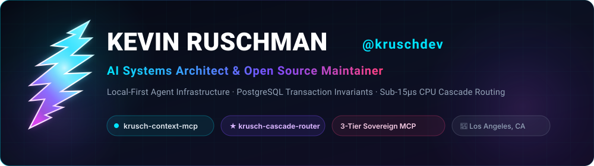
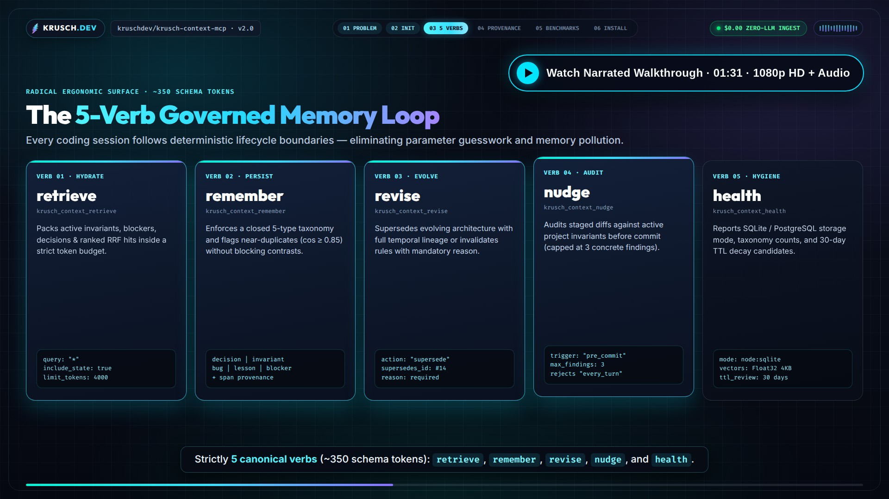
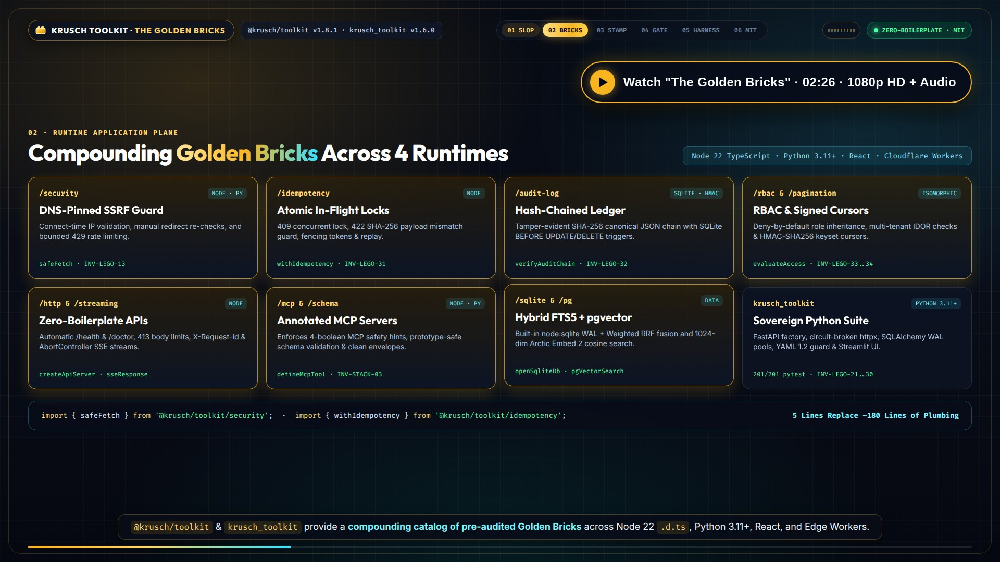
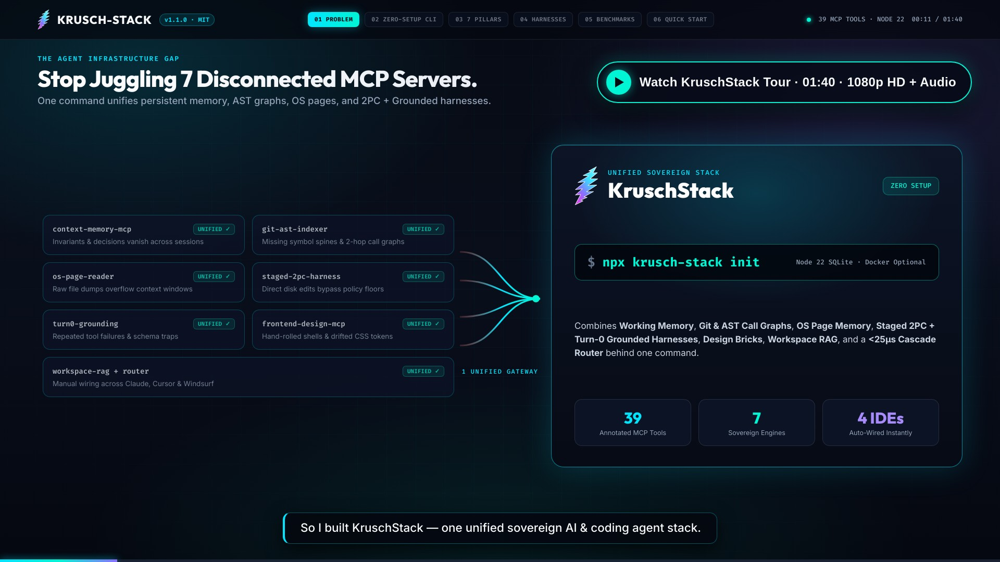
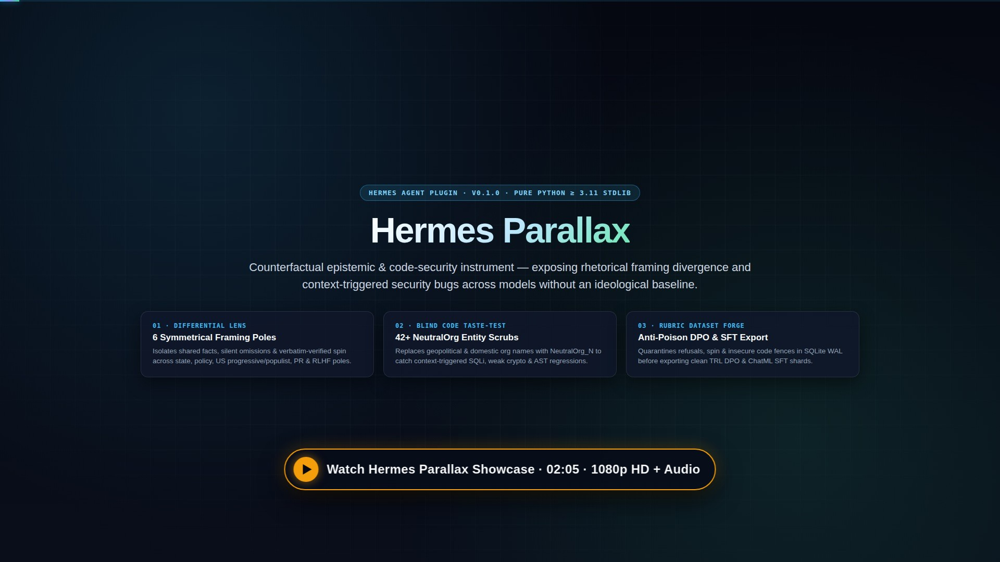
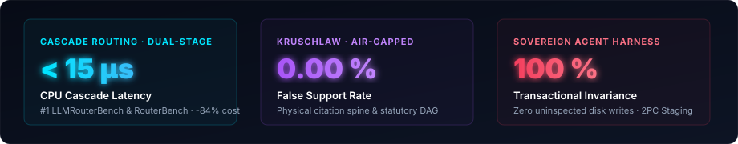

<div align="center">

  

  <br/><br/>

  [](https://krusch.dev)
  [](https://krusch.dev/resume)
  [](https://huggingface.co/krush420)
  [](https://www.linkedin.com/in/kevin-saylor-ruschman-1080493a3/)
  [](https://x.com/Kev96790724)

</div>

<br/>

# Kevin Ruschman

**AI Infrastructure Engineer | Agent Systems | Reliability & Verification** — *"I build the reliability infrastructure that makes autonomous AI systems safe, persistent, and useful"*  
`Independent R&D Lab · Open to Senior, Staff, or Principal engineering roles across agent infrastructure, persistent memory, model orchestration, sandboxed code execution, and AI reliability/evaluation` · Los Angeles, CA / Remote / Hybrid · [**Portfolio (`krusch.dev`) ↗**](https://krusch.dev) · [**Resume ↗**](https://krusch.dev/resume)

I design and build **open-source agent infrastructure, transactional execution harnesses, persistent working-memory substrates, and cost-disciplined multi-GPU inference routers**. Rather than treating language models as self-policing control planes, I run them as stateless compute samplers bounded by **`PostgreSQL` ACID state**, **`<32ms` two-phase commit (`2PC`) write-ahead diff journals + POSIX atomic rename**, **`<15µs` pure-CPU Stage-0 cascade dispatch**, **`<1ms` static AST checks**, and **hermetic verification gates**.

> **Lab Provenance:** Independent R&D lab and open-source engineering research. Projects, evaluations, and reference architectures are developed and tested in my own lab unless otherwise indicated.

---

### 🛠️ Open-Source Engineering & Failure-Mode Design

```bash
# Run the unified 7-pillar, 39-tool MCP runtime locally in one command (Node.js 22+ SQLite WAL or PostgreSQL 16)
npx krusch-stack init --ide all --defer-tools && npx krusch-stack doctor
```

<table>
  <tr>
    <td width="50%" align="center" valign="top">
      <a href="https://krusch.dev/assets/video/krusch-context-mcp-demo.mp4"></a>
      <sub><strong><a href="https://krusch.dev/assets/video/krusch-context-mcp-demo.mp4">▶ krusch-context-mcp v2.0 (01:31)</a></strong><br/>5-verb SQLite/PG memory &amp; SHA-256 span provenance</sub>
    </td>
    <td width="50%" align="center" valign="top">
      <a href="https://krusch.dev/assets/video/krusch-toolkit-golden-bricks.mp4"></a>
      <sub><strong><a href="https://krusch.dev/assets/video/krusch-toolkit-golden-bricks.mp4">▶ @krusch/toolkit v1.8.1 (02:26)</a></strong><br/>39 runtime Golden Bricks &amp; 16 &lt;1ms AST guards</sub>
    </td>
  </tr>
  <tr>
    <td width="50%" align="center" valign="top">
      <a href="https://krusch.dev/assets/video/krusch-stack-tour.mp4"></a>
      <sub><strong><a href="https://krusch.dev/assets/video/krusch-stack-tour.mp4">▶ krusch-stack v1.1.0 (01:40)</a></strong><br/>Unified 7-pillar, 39-tool stack &amp; 2PC + Grounded harnesses</sub>
    </td>
    <td width="50%" align="center" valign="top">
      <a href="https://krusch.dev/assets/video/hermes-parallax-showcase.mp4"></a>
      <sub><strong><a href="https://krusch.dev/assets/video/hermes-parallax-showcase.mp4">▶ Hermes Parallax v0.1.0 (02:05)</a></strong><br/>6-pole epistemic framing, blind AST counterfactuals &amp; DPO forge</sub>
    </td>
  </tr>
</table>

#### 1. [`krusch-context-mcp`](https://github.com/kruschdev/krusch-context-mcp) `v2.0.0` — Persistent Agent Working Memory & Span Provenance ([▶ Video `01:31`](https://krusch.dev/assets/video/krusch-context-mcp-demo.mp4))
- **Architecture & Adoption (`82★` · `7` forks · `86` monthly npm downloads · `144/144` tests):** 5-verb Model Context Protocol (MCP) memory engine (`retrieve`, `remember`, `revise`, `nudge`, `health`) backed by `PostgreSQL 16 + pgvector HNSW` or zero-Docker `node:sqlite` WAL + external-content Porter `FTS5`. Enforces **`INV-12` SHA-256 line-span provenance** (flagging `STALE_DRIFT` when anchored source lines mutate so stale rules never silently steer edits) and **`$0.00` zero-LLM `Raw-RAG`** (`256/32`-token sliding conversation windows + 4-Way Hybrid RRF).
- **Scope & Limitations:** Zero-LLM `Raw-RAG` eliminates write-time LLM summarization cost and ingestion hallucination, leaving a **`1.67%` implicit-synthesis miss floor** (`10/600` `DolphinBench` tasks unresolved across `Oracle@28`) when cross-session constraints share neither lexical tokens nor dense semantic neighborhood at index time.
- **Supporting Benchmarks:** **`90.26%` accuracy & `95.77%` `dia_id` recall** across all `1,540/1,540` Official Snap `LoCoMo` (`ACL 2024`) QA probes at `$0.00` ingestion (`89.68%` `argon_tight` @ `6.73x` compression, `92.66%` `Oracle@2`, clean-room evaluation); **`91.17%` (`547/600` @ `$24.54`, `Gemini 4 Argon Low`)** — **uploaded `dolphinbench.ai` submission (`UUID c047b063`, `status: "queued"` awaiting leaderboard acceptance; exceeds current `70.67%` published leaderboard entry in independent `600/600` evaluation)**, **`90.67%` (`544/600` @ `$30.54`, `Argon Low + Grounded v0.3`, `90.50%` on `Riley`)** — **self-run clean-room evaluation (highest `Riley` slice `181/200 = 90.50%`, published SHA-256 audit logs)**, and **`57.33%` (`344/600` @ `$0.00`, Wave-6 `krush420/gemma4-31b-sre-lora` + `Grounded`)** — **highest open-weights score in self-run 28-run evaluation (`$0.00`; `54.17%` [`325/600`] stock submission `UUID 288671ad` uploaded & queued on `dolphinbench.ai`)** across `28` `DolphinBench` runs (`16,800` `gpt-5.6-sol` traces, `98.33%` `Global Oracle@28`); **`93.00%` `10M`-token IE recall** across `2,000` Official ICLR 2026 `BEAM` probes.

#### 2. [`@krusch/toolkit`](https://github.com/kruschdev/toolkit) `v1.8.1` (JS/TS) & `krusch_toolkit` `v1.6.0` (Python) — Certified Runtime Bricks & Static Guards ([▶ Video `02:26`](https://krusch.dev/assets/video/krusch-toolkit-golden-bricks.mp4))
- **Architecture & Test Rigor (`39` runtime bricks · `64` `.d.ts` subpaths · `141/141` Node & `201/201` `pytest` tests):** Pre-audited infrastructure primitives replacing LLM-regenerated boilerplate: connect-time DNS-pinned SSRF guards (`safeFetch`), bounded HTTP `413` stream parsers, atomic `Idempotency-Key` locks (`409`/`422`), hash-chained SHA-256/SQLite `audit-log` ledgers, zero-`node:*` `rbac`/IDOR guards, and HMAC keyset `pagination`. Paired with `krusch-lego`'s **`16` `<1ms` static/AST vulnerability & boilerplate detectors** and `7` zero-LLM project blueprints—validated externally on **`OWASP/NodeGoat`**, **`node-express-realworld-example-app`**, and **`stripe-samples/accept-a-payment`** (plus `104/104` lab repository compliance).
- **Scope & Limitations:** The `16` `<1ms` static/AST detectors enforce structural security and reliability boundaries (raw `fetch` SSRF, unguarded multipart uploads, `yaml.load` alias bombs, missing idempotency/RBAC wrappers), **not** domain-specific business logic or multi-service state invariants, which still require integration suites and independent code review.
- **Supporting Benchmarks:** Lifts autonomous open-weights brick adoption from **`25%` → `100%`** under pre-commit MCP diff gating and 2-stage QLoRA + DPO calibration ([**Architecture Paper ↗**](https://krusch.dev/articles/lego-system-for-code)).

#### 3. [`krusch-coding-harness`](https://github.com/kruschdev/krusch-coding-harness) + [`grounded-harness`](https://github.com/kruschdev/grounded-harness) `v0.2.0` (& Unified [`krusch-stack`](https://github.com/kruschdev/krusch-stack) `v1.1.0`) — Transactional `2PC` & Turn-0 Execution Plane ([▶ Video `01:40`](https://krusch.dev/assets/video/krusch-stack-tour.mp4))
- **Architecture & Crash Recovery (`116/116` + `7/7` harness tests · `68/68` stack tests):** Stages agent edits inside a **`PostgreSQL` write-ahead apply journal (`<32ms`)** and commits via **POSIX atomic `renameSync`/`fsync` + pre-commit SHA-256 file-drift guards**, verified under a **real SIGKILL-mid-apply crash test** (`crash-smoke.test.js`: kill -9 after the first rename, then `recoverInFlightApplies()` restores the tree). Paired with Bubblewrap sandboxes, Turn-0 workspace grounding, passive `BLOCK_SPIN_LOOP` tool memoization, live-state delta hydration, and `0`-turn defect-only stop verification (`INV-GH-01..10`).
- **Scope & Limitations:** Pre-apply SHA-256 digest checks + POSIX atomic `renameSync`/`fsync` prevent partial writes and torn multi-file batches on process crash, though a **sub-millisecond TOCTOU window** remains if an external host editor mutates the same checkout concurrently outside container or `git worktree` isolation.
- **Supporting Benchmarks:** **`90.67%` (`544/600` @ `$30.54`, `Argon Low + Grounded v0.3`, `+1.50 pp` over `v0.2`)** on `DolphinBench` (**self-run clean-room evaluation — highest `Riley` slice `181/200 = 90.50%`, published SHA-256 audit logs**); **`90.0%` (`-74.5%` cost, `2.54x` faster)** on `adyen/DABstep` (`2x` accuracy to `40.0%` @ `$0.00` on `Gemma 4 31B`); **`0.00%` attack success rate (`0/949` prompt-injection attacks across `1,046` episodes)** on ETH SpyLab `AgentDojo v1.2.2`; **`59.9%` → `66.3%`** at **`-80.7%` schema tokens** on UC Berkeley `BFCL v3 Live` (`2,251` Qs).

#### Companion Open-Source Systems

| System | Engineering Focus | Failure-Mode Design & Empirical Evaluation |
| :--- | :--- | :--- |
| [**`krusch-cascade-router`**](https://github.com/kruschdev/krusch-cascade-router) | `<15µs` Inference Cascade & Circuit Breakers | Pure-CPU Stage-0 feature dispatch + `HALF_OPEN` tier circuit breakers & live SSE logprob aborts (`-48.0%` `120B` TTFT, `1,442x` faster `Polyglot` routing). **`0.7263` across `8,400/8,400` live receipts on [`RouteWorks/RouterArena` PR #169](https://github.com/RouteWorks/RouterArena/pull/169) (`github-actions[bot]` CI-verified upstream PR)** (`74.44%` acc @ `$0.38/1K`, `91.43%` rob., `26.4x` cheaper than `GPT-5`); clean-room self-run evaluations on Martian `RouterBench` (`36,497` Qs, `0.7488`/`0.7695` `AIQ`) & ACL 2026 `LLMRouterBench` (`-83.95%` cost). |
| [**`krusch-git`**](https://github.com/kruschdev/krusch-git) & [**`krusch-fs-mcp`**](https://github.com/kruschdev/krusch-fs-mcp) | AST Blast-Radius & OS Page Memory | 2-hop AST call-graph blast-radius checks before signature edits + SHA-256 page-anchored OS config memory. **`56.40%` 10-task Macro `NDCG@10`** in clean-room **ACL 2025 `CoIR`** evaluation (`2.39M` docs / `162,216` Qs, `> Voyage-Code-002` `56.26%` 512-tok baseline); beats `CodeBERT` & `UniXcoder` across `47,998` `RepoBench-R` queries. |
| [**`Jean SRE`**](https://github.com/kruschdev/Jean-SRE-by-kruschdev) & [**`@krush420`**](https://huggingface.co/krush420) | Hermetic SRE Daemon & QLoRA Distillation | Containerized repository audit daemon + Rule-of-3 scouting; published [**`18,131` Zero-Leak SFT + DPO rows**](https://huggingface.co/datasets/krush420/sovereign-code-audit-sft) training [**`gemma4-31b-sre-lora` (`57.33%` @ `$0.00` — highest open-weights score in self-run 28-run evaluation)**](https://huggingface.co/krush420/gemma4-31b-sre-lora), [**`120B` Teacher**](https://huggingface.co/krush420/gpt-oss-120b-sre-lora), [**`30B` Student (`43.00%`)**](https://huggingface.co/krush420/qwen3-coder-30b-sre-lora), & [**`8B` Edge (`15.7x` lift)**](https://huggingface.co/krush420/llama3-hermes3-8b-sre-lora). |
| [**`krusch-law`**](https://github.com/kruschdev/krusch-law) & [**`krusch-nexus`**](https://github.com/kruschdev/krusch-nexus) | Evidentiary Citation Spines & DBOS Workflows | Layout-true Poppler TSV document spines (`100%` held-out citation accuracy) + two-pass proposition entailment enforcing a **`0.00%` False Support Rate**; **`26.74%` Macro F1 (`k=1`) & `44.72%` Recall (`k=2`)** across `6,889` **Stanford `LegalBench-RAG`** queries (`714` contracts). |
| [**`Hermes-Parallax`**](https://github.com/kruschdev/Hermes-Parallax) | Epistemic Triangulation & Blind AST Counterfactuals | Zero-dependency Nous Hermes Agent plugin ([**Catalog PR #153023**](https://github.com/NousResearch/hermes-agent/pull/153023), `10/10` `pytest`, `15/15` validator checks): 6 symmetrical US/global framing poles with Mandarin tokenization + verbatim quote verification, blind AST security entity-scrubbing (`168` runs across `7` models), and `O_NOFOLLOW` poison-quarantined DPO curation. |

---

### 🔧 Engineering Background

Before focusing full-time on AI infrastructure, I spent nine years (`2014–2023`) diagnosing and installing applied electrical and mechanical systems in Southern Vermont, directed mobile field-diagnostic crews for the Wisconsin Bicycle Federation, and built and operated a physical retail and service business to first-year profitability in Aspen, Colorado (building on earlier Eagle Scout leadership). Working where miswired circuits, missed mechanical tolerances, and unhedged operating costs fail immediately shaped my engineering instincts around failure modes and operational accountability. That background is why I govern language models with deterministic engineering gates—`PostgreSQL` ACID state, `<15µs` pure-CPU dispatch, and `<1ms` static AST checks—rather than relying on unverified LLM behavior.

---

### 📊 Supporting Benchmarks & 3-Category Verification Taxonomy

<div align="center">
  
</div>

**Evaluated across 335,000+ traces and 14 external benchmark suites, with published SHA-256 audit logs and reproducible evaluation artifacts** (`95/95` SHA-256 clean-room verification gates across **`49` Hugging Face audit logs in `64` files** + `15/15` `adyen/DABstep` gates + `5/5` Official Snap `LoCoMo` gates, enforcing runtime JS `Proxy` oracle-leakage traps, `0o444` read-only SQLite freezes, and loopback air-gaps on open-weights runs). Every external score is disclosed under one of three explicit verification categories:

1. **`github-actions[bot]` CI-Verified Upstream PR:** [`RouteWorks/RouterArena` PR #169](https://github.com/RouteWorks/RouterArena/pull/169) (`0.7263` Arena Score across `8,400/8,400` live OpenRouter receipts + `420` robustness noise perturbations; open upstream PR awaiting maintainer merge).
2. **Uploaded `dolphinbench.ai` Submissions (`status: "queued"` Awaiting Leaderboard Acceptance):** `91.17%` (`547/600` @ `$24.54`, `Gemini 4 Argon Low`, `UUID c047b063` — exceeds current `70.67%` published leaderboard entry in independent `600/600` evaluation), `89.17%` (`535/600` @ `$24.57`, `Argon Medium`, `UUID 29389157`), and `54.17%` (`325/600` @ `$0.00`, `Google Gemma 4 31B` stock, `UUID 288671ad`), among `8` uploaded `.zip` archives passing `submission.validate`.
3. **Independently Reproduced Clean-Room Evaluations (Published SHA-256 Audit Logs):** `90.67%` (`544/600` @ `$30.54`, `Argon Low + Grounded v0.3` — highest `Riley` slice `181/200 = 90.50%`), `57.33%` (`344/600` @ `$0.00`, Wave-6 [`krush420/gemma4-31b-sre-lora`](https://huggingface.co/krush420/gemma4-31b-sre-lora) + `Grounded` — highest open-weights score in self-run 28-run evaluation), Official Snap `LoCoMo` (`90.26%` accuracy / `95.77%` `dia_id` recall), ETH SpyLab `AgentDojo v1.2.2` (`0.00%` ASR), `adyen/DABstep` (`90.0%`), ACL 2025 `CoIR`, ICLR 2026 `BEAM`, `BFCL v3 Live`, `Aider Polyglot`, `BIRD-SQL`, `RepoBench-R`, `LegalBench-RAG`, `RouterBench`, and `LLMRouterBench`: [**Full Methodology & Honest Gaps (`BENCHMARKS.md`) ↗**](https://github.com/kruschdev/krusch-stack/blob/main/BENCHMARKS.md) · [**Raw SHA-256 Logs on Hugging Face ↗**](https://huggingface.co/datasets/krush420/sovereign-g4-benchmarks).

---

### 🧰 Technical Stack

- **Languages & Runtimes:** `JavaScript / TypeScript` (`Node.js 22+ ESM`, `React`, `Vite`, `Express`, `Cloudflare Workers`, `oxlint`) · `Python 3.12` (`FastAPI`, `SQLAlchemy 2.0`, `Pydantic v2`, `PyTorch`, `asyncio`) · `SQL`
- **State, Graph & Search:** `PostgreSQL 16` (`pgvector` HNSW, `tsvector` GIN, Hybrid RRF) · `node:sqlite` WAL + external-content Porter `FTS5` · `snowflake-arctic-embed2` (`8,192`-ctx, `1,024`-dim, asymmetric `query:` calibration)
- **Infrastructure & LLMOps:** Multi-Node Bare-Metal Linux (`10GbE`, `systemd`, `Docker`, `Bubblewrap` sandboxes) · `Ollama` / `vLLM` (`q8_0` KV) · `96GB RTX PRO 6000 Blackwell` QLoRA + DPO · `GitHub Actions CI`

---

### 📖 Selected Architecture Writing ([All 27 Papers on krusch.dev →](https://krusch.dev/articles/))

- [**Why Coding Agents Need Release-Gated Lego Bricks, Not Prompted Boilerplate: Inside a 39-Brick, Self-Evolving Code Substrate**](https://krusch.dev/articles/lego-system-for-code) — Eliminating LLM-regenerated HTTP `413` TCP `RST` races, DNS-rebinding SSRF, FTS5 injection, idempotency races, mutable audit logs, IDOR leaks, and YAML alias bombs across `104/104` (`100%`) lab repositories using [`@krusch/toolkit` `v1.8.1` & `krusch_toolkit` `v1.6.0`](https://github.com/kruschdev/toolkit) (`16` `<1ms` static/AST detectors) and pre-commit MCP diff guards.
- [**The Krusch Coding Harness**](https://krusch.dev/articles/krusch-coding-harness) — Designing a `PostgreSQL` write-ahead apply journal, POSIX atomic `renameSync`/`fsync` swap engine, mid-commit crash-injection harness, and pre-commit SHA-256 drift gate for autonomous coding agents.
- [**Beyond Flat Vector RAG: What Makes `krusch-context-mcp` Special**](https://krusch.dev/articles/what-makes-krusch-context-mcp-special) — 5-verb hierarchical working memory, temporal lineage (`supersedes_id`), and `INV-12` SHA-256 line-span drift checks across `100K`–`10M` tokens.
- [**Return on Memory: Why Test-Time Reasoning Unlocks Zero-Distillation Agentic Retrieval on Official DolphinBench (`91.17%` Queued `UUID c047b063` & `90.67%` Clean-Room Grounded v0.3)**](https://krusch.dev/articles/return-on-memory-dolphinbench) — Controlled `28`-run (`16,800`-trace) study over frozen `0o444` SQLite checkpoints (`$0.00` Raw-RAG + 4-Way RRF): `90.26%` accuracy & `95.77%` `dia_id` recall on Official Snap `LoCoMo`, `98.33%` (`590/600`) `Global Oracle@28`, `81.50%` @ `$1.35` on model-matched `GPT 5.6 Luna + Grounded` (`71.1x` cheaper than `Mem0`), and `57.33%` @ `$0.00` (highest open-weights score in self-run 28-run evaluation; `54.17%` stock `UUID 288671ad` queued) on [`krush420/gemma4-31b-sre-lora`](https://huggingface.co/krush420/gemma4-31b-sre-lora).
- [**How an Open-Weights Sovereign Stack Stacks Up Across 335,000+ Benchmark Queries & Traces (Including Where Cloud Still Wins)**](https://krusch.dev/articles/how-krusch-stack-stacks-up) — Evaluated across 335,000+ traces and 14 external benchmark suites, with published SHA-256 audit logs and reproducible evaluation artifacts (`95/95` SHA-256 clean-room gates, `49` Hugging Face audit logs across `64` files), including honest open-weights ceilings and reproduction commands.
- [**Multi-Tier Cascade Routing Architecture**](https://krusch.dev/articles/multi-tier-cascade-routing) — `<15µs` pure-CPU Stage-0 dispatch, `HALF_OPEN` circuit breakers, live SSE logprob aborts (`-48.0%` TTFT), `github-actions[bot]` CI-verified upstream `RouteWorks/RouterArena` PR #169 (`0.7263` across `8,400/8,400` live receipts), and clean-room self-run evaluations on Martian `RouterBench` & ACL 2026 `LLMRouterBench`.
- [**The 15 Production Agentic Systems: Reference Architecture, State-Machine Invariants & Benchmark Proofs**](https://krusch.dev/articles/fifteen-production-agent-systems) — Architectural teardowns covering `100+` async orchestration, typed Pydantic v2 swarms, `72h` Slack HMAC HITL leases, `100`-trajectory Golden DAG CI gates, `$0.50` cost kill-switches, and `5%` shadow diffing.

---

<div align="center">
  <sub>Engineered by <strong>Kevin Ruschman (@kruschdev)</strong> · Los Angeles, CA · <a href="https://krusch.dev">krusch.dev</a></sub>
</div>
