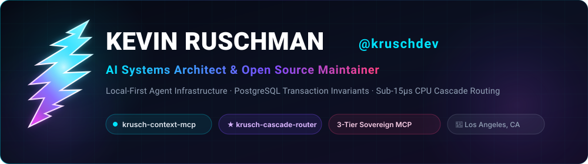
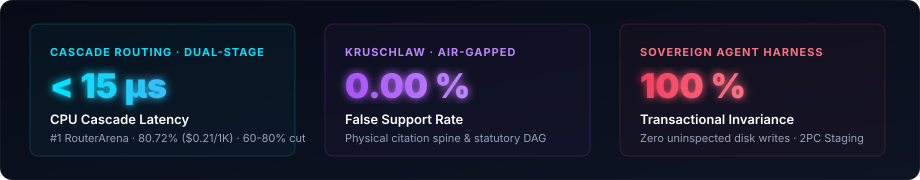

<div align="center">

  

  <br/><br/>

  [](https://krusch.dev)
  [](https://krusch.dev/resume.html)
  [](https://huggingface.co/krush420)
  [](https://www.linkedin.com/in/kevin-saylor-ruschman-1080493a3/)
  [](https://x.com/Kev96790724)

</div>

<br/>

I architect **deterministic AI infrastructure, relational working-memory substrates, transactional coding harnesses, and bare-metal multi-GPU inference pipelines**. Instead of wrapping fragile prompts around metered cloud APIs, I treat language models as stateless compute samplers governed by **PostgreSQL ACID state**, **sandboxed verification**, and **empirical benchmarks**.

---

### ⚡ Core Engineering Strengths

- **Stateful Agent Substrates & Long-Horizon Memory:** Designing bounded Model Context Protocol (MCP) engines backed by `PostgreSQL 16 + pgvector HNSW`, zero-Docker `node:sqlite` WAL, and Porter `FTS5`—proven across **10M-token** horizons where flat sliding-window RAG collapses.
- **Transactional Safety & Cross-Family Verification:** Building fail-closed execution harnesses with Bubblewrap sandboxes, `<32ms` two-phase commit (`2PC`) diff journals, AST call-graph blast-radius gates, and **Cross-Family Referee Consensus** (`Qwen3` generators audited by orthogonal `Gemma 4` & `Hermes 3` models).
- **Cost-Disciplined Bare-Metal LLMOps & Post-Training:** Operating an 8-node `10GbE` Linux GPU cluster (`57GB+` pinned local VRAM, zero CPU spill) with on-demand **96GB Blackwell** burst compute, `<15µs` cascade routing (**60–80% cost cut**), and test-gated **120B / 30B QLoRA self-distillation**.
- **Zero-Hallucination Evidentiary Retrieval:** Engineering layout-true Poppler TSV document spines (`100%` held-out citation accuracy) and two-pass proposition entailment pipelines enforcing a **0.00% False Support Rate** on statutory and contract corpora.
- **Real-World Operational Ownership:** Pairing high-velocity `Node.js 22 ESM`, `TypeScript`, and `Python 3.12` systems engineering across 27+ CI-verified repos with prior hands-on leadership in commercial NEC electrical diagnostics and brick-and-mortar P&L operations—shipping systems that fail closed and hold up in production.

---

### 📊 Verified Systems Benchmarks

<div align="center">
  
</div>

---

### 🚀 Flagship Open-Source Systems

```bash
# Run the full 7-pillar, 39-tool MCP ecosystem locally in one command (Node.js 22+ SQLite WAL or PostgreSQL 16)
npx krusch-stack init --ide all --defer-tools && npx krusch-stack doctor
```

| System | Focus | Verified Engineering Impact |
| :--- | :--- | :--- |
| [**`krusch-stack`**](https://github.com/kruschdev/krusch-stack) `v1.0.0` | Unified Agent Stack | 1-command installer (`npx` / Docker) bundling **39 annotated MCP tools** across 7 pillars; Okapi BM25 deferred loading cuts upfront schema tokens by **68.5%**. |
| [**`krusch-context-mcp`**](https://github.com/kruschdev/krusch-context-mcp) `v2.0.0` | Agent Working Memory | 5-verb hierarchical memory & SHA-256 drift gate. Benchmarked across all **2,000 Official ICLR 2026 BEAM (`100K`–`10M` tok)** questions—beating cloud `past.dev` on Contradiction Resolution (all 4 splits) & `10M` Multi-Session Reasoning. |
| [**`krusch-cascade-router`**](https://github.com/kruschdev/krusch-cascade-router) | Inference Routing | **#1 on ACL 2026 LLMRouterBench** ([`0.4269` Pareto, `-83.95%` cost](https://huggingface.co/datasets/krush420/sovereign-g4-benchmarks) across `12,566` prompts & unseen OOD `ARC-AGI`/`HLE`) & **#1 on RouterArena** (PR #169 · `80.72%` @ `$0.21/1K`); live SSE logprob abort cuts `120B` TTFT **`-48.0%`** & routes agentic `Polyglot` **`1,442x` faster** than LLM preflight (`51.7%` `Pass@2`). |
| [**`Jean SRE`**](https://github.com/kruschdev/Jean-SRE-by-kruschdev) & [**`@krush420`**](https://huggingface.co/krush420) | Autonomous SRE & QLoRA | 24/7 daemon sweeping 88 targets in hermetic test sandboxes; published [**17,899 test-verified SFT rows**](https://huggingface.co/datasets/krush420/sovereign-code-audit-sft) to train 4-bit MXFP4 [**120B Teacher**](https://huggingface.co/krush420/gpt-oss-120b-sre-lora) & [**30B Student**](https://huggingface.co/krush420/qwen3-coder-30b-sre-lora) QLoRA adapters. |
| [**`krusch-git`**](https://github.com/kruschdev/krusch-git) · [**`krusch-fs-mcp`**](https://github.com/kruschdev/krusch-fs-mcp) · [**`krusch`**](https://github.com/kruschdev/krusch) | Code, Fleet FS & `2PC` | **RepoBench-R (`47,998` Qs):** beats `CodeBERT` & `UniXcoder` across Py (`31.3%`) & Java (`27.5%` `cfr`); **Aider Polyglot (`225` tasks):** `2PC` `Verify-on-Stop` lifts `120B` **`19.6%` → `51.6%` (`2.64x`)**, tying `Claude 3.5 Sonnet` (`51.6%`) at `$0` API cost. |
| [**`krusch-law`**](https://github.com/kruschdev/krusch-law) & [**`krusch-nexus`**](https://github.com/kruschdev/krusch-nexus) | Evidentiary RAG | **`0.00%` False Support Rate** statutory DAGs & citation spines; **LegalBench-RAG (`6,889` Qs / `714` docs):** **`26.74%` Macro F1 (`k=1`) & `25.81%` F1 / `44.72%` Recall (`k=2`)** (`33.95%` `MAUD` R@2 > OpenAI `3-large` + Cohere R@64 `28.28%`). |

---

### 🧰 Technical Stack

- **Languages & Runtimes:** `JavaScript / TypeScript` (`Node.js 22+ ESM`, `React`, `Vite`, `Express`, `Cloudflare Workers`, `oxlint`) · `Python 3.12` (`FastAPI`, `SQLAlchemy 2.0`, `Pydantic v2`, `PyTorch`, `asyncio`) · `SQL`
- **State, Graph & Search:** `PostgreSQL 16` (`pgvector` HNSW, `tsvector` GIN, Hybrid RRF) · `node:sqlite` WAL + external-content Porter `FTS5` · `snowflake-arctic-embed2` (`8,192`-ctx, `1,024`-dim, asymmetric `query:` calibration)
- **Infrastructure & LLMOps:** Multi-Node Bare-Metal Linux (`10GbE`, `Tailscale`, `systemd`, `Docker`, `Bubblewrap`) · `Ollama` / `vLLM` (`q8_0` KV) · `96GB RTX PRO 6000 Blackwell` MXFP4 QLoRA · `GitHub Actions CI`

---

### 📖 Selected Architecture Writing ([All 22 Papers on krusch.dev →](https://krusch.dev/articles/))

- [**The 2026 Sovereign AI Tech Stack**](https://krusch.dev/articles/the-sovereign-ai-tech-stack.html) — Multi-family GPUs, 3-Tier MCP substrates, zero-bloat runtimes, and closed-loop QLoRA distillation.
- [**Multi-Tier Cascade Routing Architecture**](https://krusch.dev/articles/multi-tier-cascade-routing.html) — `#1` on ACL 2026 `LLMRouterBench` (`-83.95%` cost) & `RouterArena` (`0.7883`), live SSE logprob aborts (`-48.0%` TTFT), and `1,442x` faster agentic `Polyglot` routing.
- [**Beyond Flat Vector RAG: What Makes `krusch-context-mcp` Special**](https://krusch.dev/articles/what-makes-krusch-context-mcp-special.html) — 5-verb hierarchical working memory, temporal lineage, and SHA-256 span-drift checks across `100K`–`10M` tokens.
- [**The Krusch Coding Harness**](https://krusch.dev/articles/krusch-coding-harness.html) — Why autonomous code agents require a PostgreSQL `2PC` transaction manager rather than a prompt.

---

<div align="center">
  <sub>Engineered by <strong>Kevin Ruschman (@kruschdev)</strong> · Los Angeles, CA · <a href="https://krusch.dev">krusch.dev</a></sub>
</div>
