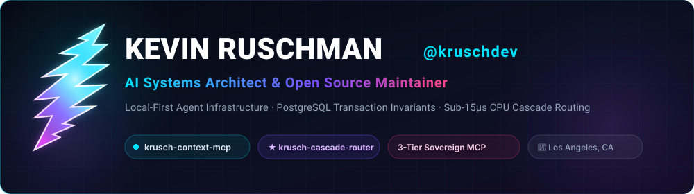
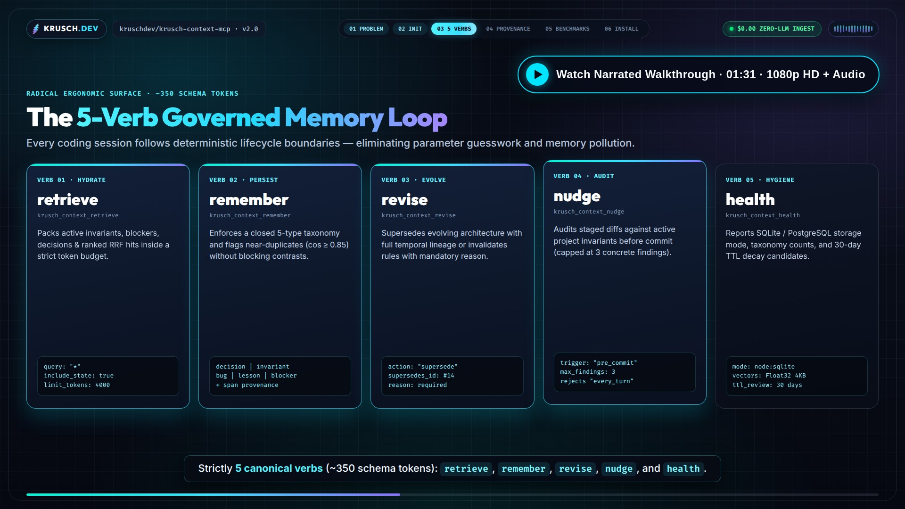
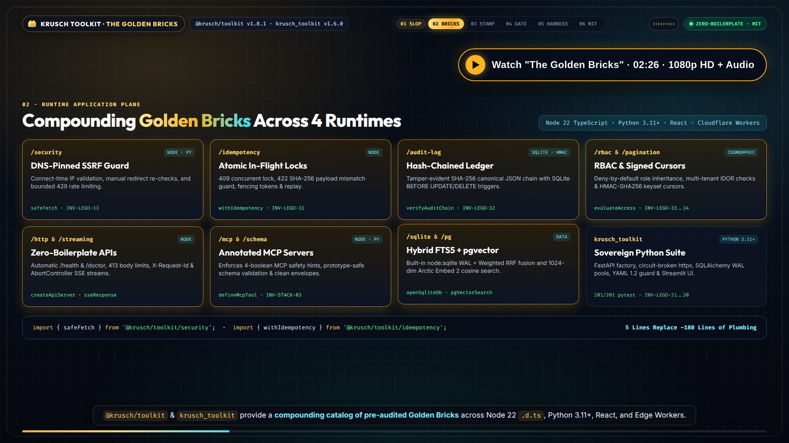
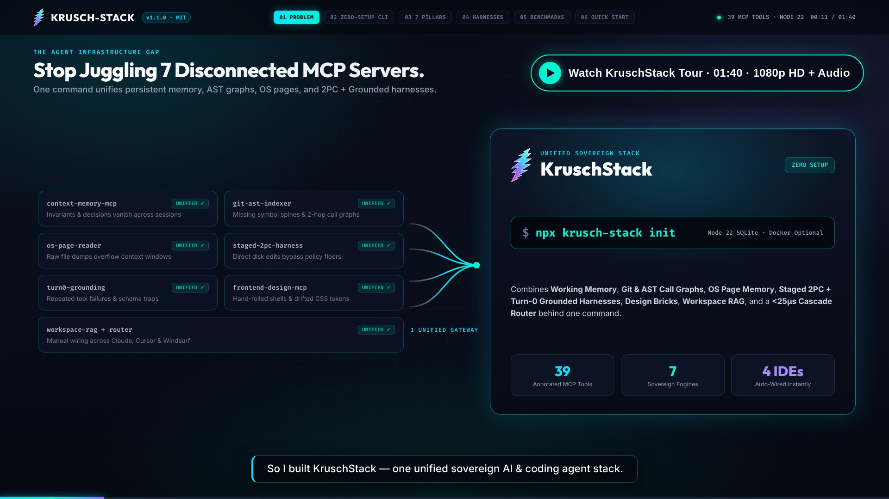
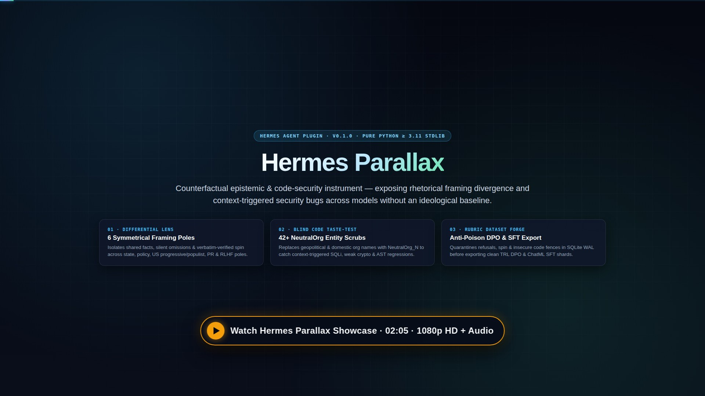
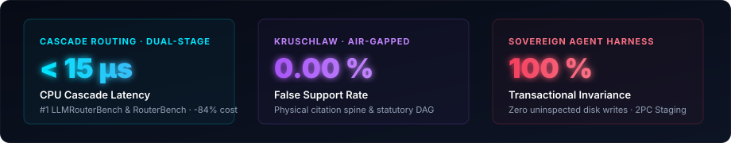

<div align="center">

  

  <br/><br/>

  [](https://krusch.dev) [](https://krusch.dev/resume) [](https://registry.modelcontextprotocol.io/v0/servers?search=dev.krusch) [](https://addonaudit.com/search/?q=dev.krusch)
  [-cb3837?style=for-the-badge&logo=npm&logoColor=white)](https://www.npmjs.com/~kruschdev)
  [](https://huggingface.co/krush420)
  [](https://www.linkedin.com/in/kevin-saylor-ruschman-1080493a3/)
  [](https://x.com/Kev96790724)

</div>

<br/>

# Kevin Ruschman

**AI Infrastructure Engineer | Agent Systems | Reliability & Verification**: *"I build the infrastructure that makes AI coding agents reliable."*  
`Target Roles: AI Infrastructure Engineer · Agent Systems Engineer · AI Reliability & Evaluation Engineer · Developer Infrastructure Engineer (AI Agents) · Open to individual-contributor roles, including senior scope depending on team needs` · Los Angeles, CA / Remote / Hybrid · [**Portfolio (`krusch.dev`) ↗**](https://krusch.dev) · [**Resume ↗**](https://krusch.dev/resume)

**In plain English:** AI coding agents break in production when they forget project rules, regenerate insecure boilerplate, or overwrite files without running tests; I build the open-source memory, pre-audited building blocks, and crash-safe sandboxes that keep them reliable.

Under the hood, rather than treating language models as self-policing control planes, I run them as stateless candidate generators bounded by **`PostgreSQL` write-ahead state**, **`<32ms` journaled multi-file apply protocols + POSIX atomic `renameSync`**, **`<15µs` pure-CPU Stage-0 cascade dispatch**, **`<1ms` static AST checks**, and **isolated sandboxed test gates**, without claiming that deterministic gates guarantee a model's plan is semantically right.

> **Lab Provenance:** Independent R&D lab and open-source engineering research. Projects, evaluations, and reference architectures are developed and tested in my own lab unless otherwise indicated.

### ⚡ Start Here (30-Second Overview)

```bash
# Run the <1s zero-cloud walkthrough, then initialize the lean 19-tool coding-agent profile (or --profile memory-only / full)
npx krusch-stack demo && npx krusch-stack init --ide all --defer-tools && npx krusch-stack doctor
```

| Flagship System | What It Solves (Plain English) | Adoption, Tests & Key Proof |
| :--- | :--- | :--- |
| [**`krusch-stack`**](https://github.com/kruschdev/krusch-stack) `v1.3.1` | Single-command CLI & MCP server bundling memory, AST search, and safe execution | [`8/8` Official MCP Registry servers](https://registry.modelcontextprotocol.io/v0/servers?search=dev.krusch) · `10` npm packages · `95/95` stack tests · [`8/8` AddonAudit `100/100`](https://addonaudit.com/search/?q=dev.krusch) |
| [**`krusch-context-mcp`**](https://github.com/kruschdev/krusch-context-mcp) `v2.0.3` | Persistent working memory that flags stale rules when anchored source lines change | `83★` · `997/mo` npm · `155/155` tests · [AddonAudit `100/100`](https://addonaudit.com/addon/dev-krusch-krusch-context-mcp/) · `90.26%` Snap `LoCoMo` (`$0` ingestion, lab run) |
| [**`@krusch/toolkit`**](https://github.com/kruschdev/toolkit) `v1.8.1` | `40` pre-audited JS/TS & Python runtime bricks + `16` `<1ms` AST security guards | `204/204` Node & `201/201` `pytest` tests · validated on `OWASP/NodeGoat` |
| [**`krusch-coding-harness`**](https://github.com/kruschdev/krusch-coding-harness) + [**`grounded-harness`**](https://github.com/kruschdev/grounded-harness) | Stages agent edits in network-off sandboxes with `SIGKILL`-recoverable atomic apply | `118/118` + `21/21` tests · [AddonAudit `100/100`](https://addonaudit.com/search/?q=dev.krusch) · `19.56% → 51.56%` `Aider Polyglot` open-weights lift (lab run) |
| [**`krusch-cascade-router`**](https://github.com/kruschdev/krusch-cascade-router) `v1.1.0` | `<15µs` CPU router & circuit breakers dispatching tasks across local/cloud models | Merged upstream in [`RouteWorks/RouterArena#169`](https://github.com/RouteWorks/RouterArena/pull/169) (`0.7263` CI score across `8,400` live queries) |
| [**`@kruschdev/pascal-plugin-electrical`**](https://github.com/kruschdev/pascal-plugin-electrical) `v0.2.6` | Standalone MIT NEC electrical authoring, load calc, 3D routing & panel schedules for Pascal Editor | `101/101` tests (`1,661` assertions) · `50` MIT `.glb` CAD models · `8` pure-Zod agent tools · selected for hosted `editor.pascal.app` ([`Issue #1`](https://github.com/kruschdev/pascal-plugin-electrical/issues/1)) |

- **Independent security & runtime audit:** [**`8/8` `dev.krusch/*` Official MCP Registry servers rated Gold `Audited` (`100/100`) on AddonAudit**](https://addonaudit.com/search/?q=dev.krusch) (`0` advisories, `0` secrets, `0` install scripts, verified offline stdio MCP handshakes across `4,890/mo` combined npm downloads).
- **Collaborating in external codebases:** [**`33` maintainer-merged upstream PRs**](#-collaborating-in-external-codebases-maintainer-merged-upstream-prs) across external Rust, TypeScript, and Python projects (`hydra-db/selfgraph`, `julianosig/easi.run`, `RouteWorks/RouterArena`, `NousResearch/hermes-agent`, `hashgraph-online/hol-guard`).
- **Transparent benchmark labeling:** [**`335,000+` evaluation traces across `14` suites**](#-benchmark-evidence--publication-status), explicitly separating CI-verified upstream merges, queued leaderboard submissions, and self-run clean-room lab logs (`49` raw SHA-256 log sets on Hugging Face).

<details>
<summary><strong>All 8 Official MCP Registry Servers (<code>8/8</code> AddonAudit Gold <code>100/100</code> · <code>0</code> Advisories · <code>0</code> Secrets)</strong></summary>

| MCP Server (`dev.krusch/*`) | Version | Tools | AddonAudit Status (`100/100`) |
| :--- | :---: | :---: | :--- |
| [**`krusch-context-mcp`**](https://github.com/kruschdev/krusch-context-mcp) | `v2.0.3` | `5` | [](https://addonaudit.com/addon/dev-krusch-krusch-context-mcp/) |
| [**`krusch-stack`**](https://github.com/kruschdev/krusch-stack) | `v1.3.1` | `19` (`39` full) | [](https://addonaudit.com/addon/dev-krusch-krusch-stack/) |
| [**`krusch-git`**](https://github.com/kruschdev/krusch-git) | `v1.2.4` | `7` | [](https://addonaudit.com/addon/dev-krusch-krusch-git/) |
| [**`krusch-coding-harness`**](https://github.com/kruschdev/krusch-coding-harness) | `v0.2.2` | `7` | [](https://addonaudit.com/addon/dev-krusch-krusch-coding-harness/) |
| [**`krusch-grounded-harness`**](https://github.com/kruschdev/grounded-harness) | `v0.2.2` | `7` | [](https://addonaudit.com/addon/dev-krusch-grounded-harness/) |
| [**`hydrascope`**](https://github.com/kruschdev/HydraScope) | `v0.1.2` | `6` | [](https://addonaudit.com/addon/dev-krusch-hydrascope/) |
| [**`krusch-frontend-mcp`**](https://github.com/kruschdev/krusch-frontend-mcp) | `v1.1.2` | `12` | [](https://addonaudit.com/addon/dev-krusch-krusch-frontend-mcp/) |
| [**`g-krusch`**](https://github.com/kruschdev/G-krusch) | `v1.0.2` | `12` | [](https://addonaudit.com/addon/dev-krusch-g-krusch/) |

</details>

---

### 🛠️ Open-Source Engineering & Failure-Mode Design

<table>
  <tr>
    <td width="50%" align="center" valign="top">
      <a href="https://krusch.dev/assets/video/krusch-context-mcp-demo.mp4"></a>
      <sub><strong><a href="https://krusch.dev/assets/video/krusch-context-mcp-demo.mp4">▶ krusch-context-mcp v2.0 (01:31)</a></strong><br/>5-verb SQLite/PG memory &amp; SHA-256 span provenance</sub>
    </td>
    <td width="50%" align="center" valign="top">
      <a href="https://krusch.dev/assets/video/krusch-toolkit-golden-bricks.mp4"></a>
      <sub><strong><a href="https://krusch.dev/assets/video/krusch-toolkit-golden-bricks.mp4">▶ @krusch/toolkit v1.8.1 (02:26)</a></strong><br/>40 runtime Golden Bricks, Brick Exchange &amp; 16 &lt;1ms AST guards</sub>
    </td>
  </tr>
  <tr>
    <td width="50%" align="center" valign="top">
      <a href="https://krusch.dev/assets/video/krusch-stack-tour.mp4"></a>
      <sub><strong><a href="https://krusch.dev/assets/video/krusch-stack-tour.mp4">▶ krusch-stack v1.3.1 (01:40)</a></strong><br/>Unified 10-pillar, 39-tool stack, 4 profiles &amp; 8/8 MCP Registry</sub>
    </td>
    <td width="50%" align="center" valign="top">
      <a href="https://krusch.dev/assets/video/hermes-parallax-showcase.mp4"></a>
      <sub><strong><a href="https://krusch.dev/assets/video/hermes-parallax-showcase.mp4">▶ Hermes Parallax v0.1.0 (02:05)</a></strong><br/>6-pole epistemic framing, blind AST counterfactuals &amp; DPO forge</sub>
    </td>
  </tr>
</table>

#### 1. [`krusch-context-mcp`](https://github.com/kruschdev/krusch-context-mcp) `v2.0.3`: Persistent Agent Working Memory & Span Provenance ([▶ Video `01:31`](https://krusch.dev/assets/video/krusch-context-mcp-demo.mp4) · [AddonAudit Gold `100/100`](https://addonaudit.com/addon/dev-krusch-krusch-context-mcp/))
- **Overview (`83★` · `6` forks · `997` monthly npm downloads · `155/155` tests):** 5-verb Model Context Protocol (MCP) memory engine (`retrieve`, `remember`, `revise`, `nudge`, `health`) backed by zero-Docker `node:sqlite` WAL + Porter `FTS5` (or optional `PostgreSQL 16 + pgvector HNSW` for multi-worker state). Anchors saved decisions to exact file line spans via SHA-256 so mutated code triggers `STALE_DRIFT` instead of silently steering edits with outdated rules.

<details>
<summary><strong>Architecture Internals, Scope Limits &amp; Supporting Benchmarks</strong> (<code>90.26%</code> Snap LoCoMo · <code>DolphinBench</code> · <code>93.00%</code> BEAM)</summary>

- **Provenance & Zero-LLM Indexing:** Pairs SHA-256 line-span provenance with zero-LLM `git blame -w -M` + co-change + causal commit-rationale alignment guards, plus `$0.00` zero-LLM `Raw-RAG` (`256/32`-token sliding conversation windows + 4-Way Hybrid RRF).
- **Scope & Limitations:** Single-machine workflows run on built-in `node:sqlite` (`npx krusch-context-mcp init`) with zero external services. Zero-LLM `Raw-RAG` eliminates write-time LLM summarization cost and ingestion hallucination, leaving a **`1.67%` implicit-synthesis miss floor** (`10/600` `DolphinBench` tasks unresolved across `Oracle@28`) when cross-session constraints share neither lexical tokens nor dense semantic neighborhood at index time.
- **Supporting Benchmarks (Self-Run in Lab):** **`90.26%` accuracy & `95.77%` `dia_id` recall** across all `1,540/1,540` Official Snap `LoCoMo` (`ACL 2024`) QA probes at `$0.00` ingestion (`89.68%` `argon_tight` @ `6.73x` compression, `92.66%` `Oracle@2`); **`81.50%` (`489/600` @ `$1.35`, model-matched `GPT 5.6 Luna + Grounded`, `71.1x` cheaper than `Mem0`)**, **`91.17%` (`547/600` @ `$24.54`, `Gemini 4 Argon Low`, uploaded `dolphinbench.ai` submission `UUID c047b063`, `status: "queued"` awaiting leaderboard acceptance)**, **`90.67%` (`544/600` @ `$30.54`, self-run `Argon Low + Grounded v0.3`, `90.50%` on `Riley`)**, and **`57.33%` (`344/600` @ `$0.00`, Wave-6 `krush420/gemma4-31b-sre-lora` + `Grounded`; `54.17%` stock `UUID 288671ad` queued)** across `28` `DolphinBench` runs (`16,800` traces); **`93.00%` `10M`-token IE recall** across `2,000` Official ICLR 2026 `BEAM` probes.

</details>

#### 2. [`@krusch/toolkit`](https://github.com/kruschdev/toolkit) `v1.8.1` (JS/TS) & `krusch_toolkit` `v1.6.0` (Python): Certified Runtime Bricks, Collaborative Brick Exchange & 4-Axis Ontology ([▶ Video `02:26`](https://krusch.dev/assets/video/krusch-toolkit-golden-bricks.mp4) · [▶ Ontology `01:38`](https://krusch.dev/assets/video/brick-exchange-ontology-launch.mp4))
- **Overview (`40` runtime bricks · `65+` `.d.ts` subpaths · `204/204` Node & `201/201` `pytest` tests · `0/256` Zero-Leak checks):** Pre-audited runtime building blocks and `16` `<1ms` static/AST security detectors that replace fragile LLM-regenerated boilerplate for HTTP/SSE, DNS-pinned SSRF protection, SQLite/Postgres pools, idempotency locks, RBAC, hash-chained audit logs, and Ed25519-sealed cross-team brick sharing.

<details>
<summary><strong>Brick Catalog, Scope Limits &amp; Adoption Benchmarks</strong> (<code>OWASP/NodeGoat</code> · 4-Axis HydraDB Ontology · <code>25% → 100%</code> Brick Adoption)</summary>

- **Core Primitives & Brick Exchange:** Includes connect-time DNS-pinned SSRF guards (`safeFetch`), bounded HTTP `413` stream parsers, atomic `Idempotency-Key` locks (`409`/`422`), hash-chained SHA-256/SQLite `audit-log` ledgers, zero-`node:*` `rbac`/IDOR guards, HMAC keyset `pagination`, zero-LLM diff/co-change/causal-commit alignment (`@krusch/toolkit/git-alignment`), persistent Wayland/CDP browser automation & `<2K`-tok UI digests (`@krusch/toolkit/easi`), Continual RSI via Self-Improvement Memory (`@krusch/toolkit/modular-rsi`, `arXiv:2611.18856` counterfactual outcome tracking), and an **Ed25519-sealed Validated Brick Exchange (`@krusch/toolkit/brick-exchange`)** combining Node 22 `--permission` fault-injection sandboxes, scoped cross-team sharing grants (adapting MIT-licensed `0xANUSHKA/common-ground-8090`), a **4-axis cross-stack HydraDB OpenCypher ontology** (`SoftwareStack`, `DataPort`, `ChannelEndpoint`, `MoEVerificationTier`, `$0` hexagonal `synthesizeBrickBinding`), `.brick-lock.json` drift locks, and 2-hop AST fan-out planning (`planAgentFanOut`, `verifyTwoHopBlastRadius`). Validated externally on **`OWASP/NodeGoat`**, **`node-express-realworld-example-app`**, and **`stripe-samples/accept-a-payment`** (plus `104/104` lab repository compliance across `7` project blueprints).
- **Scope & Limitations:** The `16` `<1ms` static/AST detectors enforce structural security and reliability boundaries (raw `fetch` SSRF, unguarded multipart uploads, `yaml.load` alias bombs, missing idempotency/RBAC wrappers), **not** domain-specific business logic or multi-service state invariants, which still require integration suites and independent code review.
- **Supporting Benchmarks:** Lifts autonomous open-weights brick adoption from **`25%` → `100%`** under pre-commit MCP diff gating and 2-stage QLoRA + DPO calibration ([**Architecture Paper ↗**](https://krusch.dev/articles/lego-system-for-code)).

</details>

#### 3. [`krusch-coding-harness`](https://github.com/kruschdev/krusch-coding-harness) + [`grounded-harness`](https://github.com/kruschdev/grounded-harness) `v0.2.2` (& Unified [`krusch-stack`](https://github.com/kruschdev/krusch-stack) `v1.3.1`): Sandboxed Staging & Crash-Recoverable Apply ([▶ 20s Live Execution](https://krusch.dev/assets/video/harness-loop-demo.mp4) · [▶ Stack Tour `01:40`](https://krusch.dev/assets/video/krusch-stack-tour.mp4))
- **Overview (`118/118` + `21/21` harness tests · `95/95` stack tests across `13` suites · [`8/8` Official MCP Registry `dev.krusch/*` servers](https://registry.modelcontextprotocol.io/v0/servers?search=dev.krusch) · [`8/8` AddonAudit `100/100`](https://addonaudit.com/search/?q=dev.krusch) · `10` npm packages / `4,890/mo` downloads):** Stages agent patches inside network-disabled `Bubblewrap` (`bwrap --unshare-net`) test sandboxes backed by a `<32ms` `PostgreSQL` write-ahead apply journal, swapping verified edits onto disk via POSIX atomic `renameSync`/`fsync` + pre-commit SHA-256 drift checks.

<details>
<summary><strong>Crash-Injection Proof, TOCTOU Scope Limits &amp; Benchmarks</strong> (<code>SIGKILL</code> Recovery · <code>51.56%</code> Aider Polyglot · <code>0/949</code> AgentDojo)</summary>

- **Crash Recovery & Progressive Profiles:** Verified under a **real `SIGKILL`-mid-apply crash test** ([`scripts/demo-full-harness-loop.mjs`](https://github.com/kruschdev/krusch-coding-harness/blob/main/scripts/demo-full-harness-loop.mjs): stage flawed patch -> fail sandbox test & reject -> repair & verify -> `SIGKILL` mid-apply & cold-worker `recoverInFlightApplies()` -> clean commit). Ships across `10` pillars (`21` SQLite + PostgreSQL DDL tables, `39` core + `23` modular extension tools) with progressive onboarding profiles (`memory-only` `5` tools, `coding-agent` `19` tools, `core` `27` tools, `full` `39` tools), Ed25519 domain-verified Official MCP Registry entries, `npx krusch-stack demo`, `npx krusch-stack explain` decision observability, and deterministic clean-room reproduction (`npm run bench:repro`).
- **Scope & Limitations:** For a single interactive developer session, an isolated `git worktree` and sandboxed test run (the zero-Docker SQLite default in `krusch-stack`) suffices; PostgreSQL write-ahead journaling targets unattended daemons and multi-worker queues. Each file swap is atomic, whereas a multi-file batch is crash-recoverable rather than atomically visible across files, and a sub-millisecond TOCTOU window remains if an uncoordinated host process mutates the same checkout outside container/worktree isolation.
- **Supporting Benchmarks (Self-Run in Lab):** **`51.56%` on `Aider Polyglot` (`225` tasks)** up from `19.56%` on the same open-weights model (driven by isolated sandbox test execution, compiler/test error feedback, and bounded repair retries fixing `72` tasks); **`0/949` hijacked (`0.00%` ASR across `1,046` episodes)** on ETH SpyLab `AgentDojo v1.2.2` (a benchmark-specific finding under active policy floors, `bwrap` sandboxes, and taint guards, not prompt-injection immunity); **`90.67%` (`544/600` @ `$30.54`, `Argon Low + Grounded v0.3`)** on `DolphinBench`; and **`-95.2%` (`42 → 2`)** duplicate MCP calls.

</details>

#### 4. [`@kruschdev/pascal-plugin-electrical`](https://github.com/kruschdev/pascal-plugin-electrical) `v0.2.6`: Deterministic NEC Electrical Engineering, 3D Trade-Priority Routing & Agent Tools for Pascal Editor ([npm](https://www.npmjs.com/package/@kruschdev/pascal-plugin-electrical) · [Hosted Pascal `Issue #1`](https://github.com/kruschdev/pascal-plugin-electrical/issues/1))
- **Overview (`101/101` tests · `1,661` assertions · `50` clean-room MIT `.glb` CAD models · `25` live equipment kinds · `8` pure-Zod `E-016` agent tools · `5/5` entry boundary & Next.js RSC gates):** Standalone MIT-licensed Residential and Commercial NEC Electrical plugin built directly on Pascal's Plugin API v1 contract so it installs via npm or pinned GitHub commit SHA without upstream core merges. Tested by the Pascal Editor maintainer for inclusion as an opt-in plugin on hosted [`editor.pascal.app`](https://editor.pascal.app) ([`Issue #1`](https://github.com/kruschdev/pascal-plugin-electrical/issues/1)).

<details>
<summary><strong>Deterministic NEC Engine, 3D Trade-Priority Routing &amp; Scope Limits</strong> (NEC Art. 220/310/314/110.26 · Cover-Off 3D Panel View · Pure Headless MCP Surface)</summary>

- **Deterministic Engineering & Cross-Trade Coordination:** Implements NEC Article `220` Residential Standard/Optional (`220.82`) and Commercial 3-phase load calculations (including `220.60` non-coincident HVAC omission and `705.12` 120% solar busbar checks), `310.16`/`310.15` ampacity derating and `240.4(D)` OCPD caps, Chapter 9 conduit fill, `314.16` box fill, local-yaw 2D SAT `110.26(A)/(E)` panel/transformer working & dedicated-space audits, door-aware `406.9(C)` wet-zone checks, and one-click NEC minimum auto-population with `@pascal-app/plugin-bones` / `structural:*` stud-bay snapping and cross-trade `plumbing:*`/`hvac:*` power ingestion.
- **3D Trade-Priority Routing, CAD & Agent Architecture:** Enforces real jobsite right-of-way (`1. Structural -> 2. Plumbing -> 3. HVAC -> 4. Electrical`) so electrical conduit and cable runs route orthogonally around higher-priority obstacles, transition through top/sole plates into attic or dry crawl-space Euclidean pulls (`NM-B`/`MC`), stagger multi-circuit parallel lanes, and count bends against the `360°` pull-point limit (`358.26`). Ships `50` procedural MIT Three.js `.glb` models, an interactive cover-off 3D panelboard interior viewer, live Odd/Even `L1/L2` or `A/B/C` schedules, priced BOM takeoff with CSV export, and strictly isolated subpath boundaries (`./render` editor-free, `./cad` React-free, `./nec` framework-free, `./agent-tools` pure Zod, `./agent-operations` headless MCP-ready).
- **Scope & Limitations:** All NEC calculations, prohibited-location checks, and BOM estimates are deterministic drafting and engineering aids, never a substitute for licensed PE review or local AHJ approval.

</details>

<details>
<summary><strong>Companion Open-Source Systems</strong> (<code>krusch-cascade-router</code> · <code>krusch-git</code> &amp; <code>HydraScope</code> · <code>Jean SRE</code> QLoRA · <code>krusch-law</code> · <code>Hermes-Parallax</code>)</summary>

| System | Engineering Focus | Failure-Mode Design & Empirical Evaluation |
| :--- | :--- | :--- |
| [**`krusch-cascade-router`**](https://github.com/kruschdev/krusch-cascade-router) | `<15µs` Inference Cascade & Circuit Breakers | Pure-CPU Stage-0 feature dispatch + `HALF_OPEN` tier circuit breakers & live SSE logprob aborts (`-48.0%` `120B` TTFT, `1,442x` faster `Polyglot` routing). **Maintainer-reviewed & merged upstream on [`RouteWorks/RouterArena` PR #169](https://github.com/RouteWorks/RouterArena/pull/169#issuecomment-6779650408) ([`main @ 844e93b`](https://github.com/RouteWorks/RouterArena/commit/844e93b547e6278b01994720de39bfc32ffd18bc); `0.7263` `github-actions[bot]` CI score across `8,400/8,400` live receipts, leaderboard row queued for next batch ranking refresh)** (`74.44%` acc @ `$0.38/1K`, `91.43%` rob., `26.4x` cheaper than `GPT-5`); clean-room self-run evaluations on Martian `RouterBench` (`36,497` Qs, `0.7488`/`0.7695` `AIQ`) & ACL 2026 `LLMRouterBench` (`-83.95%` cost). |
| [**`krusch-git`**](https://github.com/kruschdev/krusch-git), [**`krusch-fs-mcp`**](https://github.com/kruschdev/krusch-fs-mcp) & [**`HydraScope`**](https://github.com/kruschdev/HydraScope) | AST Blast-Radius, OS Memory & HydraDB Graphs | 2-hop AST call-graph blast-radius checks (`v1.2.4`, [AddonAudit `100/100`](https://addonaudit.com/addon/dev-krusch-krusch-git/)), SHA-256 page-anchored OS config memory, and self-hosted `HydraDB v0.4.0` bi-temporal OpenCypher Metric-to-Surface Dependency Graph + 4-Axis Brick Ontology (`v0.1.2`, `26/26` tests, [AddonAudit `100/100`](https://addonaudit.com/addon/dev-krusch-hydrascope/)). **`56.40%` 10-task Macro `NDCG@10`** in clean-room **ACL 2025 `CoIR`** evaluation (`2.39M` docs / `162,216` Qs, `> Voyage-Code-002` `56.26%` 512-tok baseline); beats `CodeBERT` & `UniXcoder` across `47,998` `RepoBench-R` queries. |
| [**`Jean SRE`**](https://github.com/kruschdev/Jean-SRE-by-kruschdev) & [**`@krush420`**](https://huggingface.co/krush420) | Hermetic SRE Daemon & QLoRA Distillation | Containerized repository audit daemon (`69/69` tests) + Rule-of-3 scouting; published [**`18,404` Zero-Leak SFT + DPO rows across `10` splits**](https://huggingface.co/datasets/krush420/sovereign-code-audit-sft) training [**`gemma4-31b-sre-lora` (`57.33%` @ `$0.00`, highest open-weights score in self-run 28-run evaluation)**](https://huggingface.co/krush420/gemma4-31b-sre-lora), [**`120B` Teacher**](https://huggingface.co/krush420/gpt-oss-120b-sre-lora), [**`30B` Student (`43.00%`)**](https://huggingface.co/krush420/qwen3-coder-30b-sre-lora), & [**`8B` Edge (`15.7x` lift)**](https://huggingface.co/krush420/llama3-hermes3-8b-sre-lora). |
| [**`krusch-law`**](https://github.com/kruschdev/krusch-law) & [**`krusch-nexus`**](https://github.com/kruschdev/krusch-nexus) | Evidentiary Citation Spines & DBOS Workflows | Layout-true Poppler TSV document spines (`100%` held-out citation accuracy) + two-pass proposition entailment enforcing a **`0.00%` False Support Rate**; **`26.74%` Macro F1 (`k=1`) & `44.72%` Recall (`k=2`)** across `6,889` **Stanford `LegalBench-RAG`** queries (`714` contracts). |
| [**`Hermes-Parallax`**](https://github.com/kruschdev/Hermes-Parallax) | Epistemic Triangulation & Blind AST Counterfactuals | Zero-dependency Nous Hermes Agent plugin ([**Catalog PR #153023**](https://github.com/NousResearch/hermes-agent/pull/153023), `10/10` `pytest`, `15/15` validator checks): 6 symmetrical US/global framing poles with Mandarin tokenization + verbatim quote verification, blind AST security entity-scrubbing (`168` runs across `7` models), and `O_NOFOLLOW` poison-quarantined DPO curation. |

</details>

---

### 🤝 Collaborating in External Codebases: Maintainer-Merged Upstream PRs

Building a self-directed R&D lab is different from modifying someone else's codebase under external code review. Here are external Rust, TypeScript, and Python repositories where I diagnosed bugs, followed upstream conventions, and passed maintainer review (`33` merged upstream PRs):

- **[`hydra-db/selfgraph`](https://github.com/hydra-db/selfgraph/pulls?q=is%3Apr+author%3Akruschdev+is%3Amerged) (9 Merged PRs, Rust & TypeScript):** Temporal graph engine fixes covering schema-lineage subtype expansion ([`#157`](https://github.com/hydra-db/selfgraph/pull/157)), endpoint canonicalization ([`#215`](https://github.com/hydra-db/selfgraph/pull/215)), entity-resolution case folding ([`#180`](https://github.com/hydra-db/selfgraph/pull/180)), `epochMicros` contradiction ordering ([`#167`](https://github.com/hydra-db/selfgraph/pull/167)), plus `#149`, `#156`, `#179`, `#208`, and [`#243`](https://github.com/hydra-db/selfgraph/pull/243).
- **[`RouteWorks/RouterArena`](https://github.com/RouteWorks/RouterArena/pull/169) (Merged into [`main @ 844e93b`](https://github.com/RouteWorks/RouterArena/commit/844e93b547e6278b01994720de39bfc32ffd18bc)):** Multi-tier LLM routing benchmark where maintainer `@yl231` audited all `8,400` live OpenRouter predictions and `github-actions[bot]` CI Run `#780` (`0.7263` score, `0` abnormal) before merging `PR #169`.
- **[`julianosig/easi.run`](https://github.com/julianosig/easi.run/pulls?q=is%3Apr+author%3Akruschdev+is%3Amerged) (8 Merged PRs: [`#3`](https://github.com/julianosig/easi.run/pull/3), [`#4`](https://github.com/julianosig/easi.run/pull/4), [`#5`](https://github.com/julianosig/easi.run/pull/5), [`#7`](https://github.com/julianosig/easi.run/pull/7), [`#8`](https://github.com/julianosig/easi.run/pull/8), [`#9`](https://github.com/julianosig/easi.run/pull/9), [`#10`](https://github.com/julianosig/easi.run/pull/10), [`#11`](https://github.com/julianosig/easi.run/pull/11), plus [`Issue #2`](https://github.com/julianosig/easi.run/issues/2), Rust Wayland/CDP):** Shipped navigation/editing key delivery, desktop-scoped key & `target.pid` display routing, UTF-16 `.toWellFormed()` surrogate-pair protection in `inspect_page`, `MAX_SESSIONS` frame attachment bounds, desktop/window display scroll routing, and restarted-controller unheld session cleanup across protocol, display, browser-launch, and admin crates.
- **[`NousResearch/hermes-agent`](https://github.com/NousResearch/hermes-agent/pull/153023) (Merged `PR #153023`) & [`hashgraph-online/hol-guard`](https://github.com/hashgraph-online/hol-guard/pulls?q=is%3Apr+author%3Akruschdev+is%3Amerged) (13 Merged MCP Trust-Binding PRs):** Passed `15/15` catalog validation and `plugin_guard` static checks to merge the zero-dependency `Hermes Parallax` epistemic counterfactual plugin, and merged `13` MCP server trust-binding specs (`#5270`, `#5290`, `#5291`, `#5295`, `#5296`, plus `#8052`–`#8059`).

<details>
<summary><strong>Active Open Upstream Reviews &amp; Time-Boxed Hackathon Sprints</strong> (<code>pascalorg/editor</code> · <code>pascalorg/lingo</code> · <code>trycua/cua</code> · <code>HydraScope</code> · <code>DEADBOLT</code>)</summary>

- **Open Upstream Bug-Fix PRs (Awaiting Maintainer Review):** [`pascalorg/editor`](https://github.com/pascalorg/editor) ([`#1303`](https://github.com/pascalorg/editor/pull/1303) floor procedural-item collision footprints, [`#1304`](https://github.com/pascalorg/editor/pull/1304) sloped-wall transom/sidelight door moves, [`#1305`](https://github.com/pascalorg/editor/pull/1305) saved camera projection & lens restore, [`#1308`](https://github.com/pascalorg/editor/pull/1308) physical item width/height/depth editing, [`#1309`](https://github.com/pascalorg/editor/pull/1309) deferred wall T-junction export repair, [`#1310`](https://github.com/pascalorg/editor/pull/1310) i18n validation, lazy locales & plural fallback), [`pascalorg/lingo`](https://github.com/pascalorg/lingo) ([`#9`](https://github.com/pascalorg/lingo/pull/9) second-grain date ranges, [`#10`](https://github.com/pascalorg/lingo/pull/10) minor-currency range scaling, [`#11`](https://github.com/pascalorg/lingo/pull/11) CJK compact date-offset auto-detection), [`trycua/cua#8517`](https://github.com/trycua/cua/pull/8517) (Linux AT-SPI `State::Editable` + `Text` fallback for Chromium inputs), and [`harness-hub/harness-lens#21`](https://huggingface.co/spaces/harness-hub/harness-lens/discussions/21) (`44/44` + `38/38` verified source refs).
- **Time-Boxed External Hackathon Sprints (`HydraScope` & `DEADBOLT`):** Shipped [**`HydraScope` `v0.1.2`**](https://github.com/kruschdev/HydraScope) ([Live Demo](https://hydrascope.krusch.dev) · [Write-Up](https://krusch.dev/articles/hydrascope-agent-context-on-hydradb), `26/26` tests) for the HydraDB Hackathon (self-hosted `hydradb:0.4.0` OpenCypher + `@hydradb/selfgraph` agent context layer compressing `64` MCP tool schemas by `-94.2%`, 4-axis cross-stack brick ontology, and bi-temporal metric-to-surface dependency propagation, surfacing the `9` merged `hydra-db/selfgraph` PRs above) and [**`DEADBOLT`**](https://github.com/kruschdev/deadbolt) ([Architecture Paper](https://krusch.dev/articles/deadbolt-evolve-software-factory-governance)) in-person under a 20-hour code freeze at EVOLVE (8090 AI Hackathon, Redwood City), integrating 8090's Work Order APIs and HydraDB `v0.4.0`.

</details>

---

### 🔧 Engineering Background

Before focusing full-time on AI infrastructure in late 2025, I spent twelve years (`2013–2025`) working hands-on in physical systems and operations: executing NEC-compliant residential electrical installations and remodels (panel upgrades, kitchen/bath, recording studio) and deploying festival generator and stage power across New England (`Atomic Audio & Visual`, `North Beast`, `MASS MoCA`, plus `Stratton Trail Crew`) out of Jamaica, Vermont (`2020–2025`); mentoring local teens on the Mobile Bike Repair team at the `Wisconsin Bike Fed` in Milwaukee (`2019–2020`); and owning and operating `Local Coffee` in downtown Aspen after helping launch the `Gorsuch Ski Café` at the base of Ajax Mountain and `Venue` in downtown Fairbanks, Alaska (`2013–2019`, building on Troop 883 Eagle Scout leadership leading a 9-person, 100+ hour civic project in La Habra and cycling the length of Mexico from San Diego to Chiapas and overland to Panama at age 19).

Working where miswired circuits, overloaded generators, and unhedged operating costs fail immediately shaped my engineering instincts around failure modes and operational accountability. That background is why I govern language models with deterministic engineering gates (`PostgreSQL` write-ahead state, `<15µs` pure-CPU dispatch, and `<1ms` static AST checks) rather than relying on unverified LLM behavior, and why I turned that field experience into [`@kruschdev/pascal-plugin-electrical`](https://github.com/kruschdev/pascal-plugin-electrical) for deterministic NEC design and trade-priority 3D routing inside Pascal Editor.

---

### 📊 Benchmark Evidence & Publication Status

<div align="center">
  
</div>

**Evaluated across 335,000+ traces and 14 external benchmark suites in my lab, with published SHA-256 audit logs and reproducible evaluation artifacts** (`95/95` SHA-256 clean-room verification gates across **`49` Hugging Face audit logs in `64` files**). Running a public benchmark in my own lab is distinct from third-party reproduction or leaderboard acceptance, so every score is labeled with its exact status:

1. **Maintainer-Reviewed & Merged Upstream (`github-actions[bot]` CI-Verified):** [`RouteWorks/RouterArena` PR #169](https://github.com/RouteWorks/RouterArena/pull/169#issuecomment-6779650408) (`0.7263` CI Arena Score across `8,400/8,400` live OpenRouter receipts + `420` robustness noise perturbations; merged upstream by maintainer `@yl231` into [`main @ 844e93b`](https://github.com/RouteWorks/RouterArena/commit/844e93b547e6278b01994720de39bfc32ffd18bc); leaderboard row queued for next batch ranking refresh).
2. **Uploaded `dolphinbench.ai` Submissions (`status: "queued"` Awaiting Leaderboard Acceptance):** `91.17%` (`547/600` @ `$24.54`, `Gemini 4 Argon Low`, `UUID c047b063`, exceeding the current `70.67%` published leaderboard entry in my `600/600` evaluation), `89.17%` (`535/600` @ `$24.57`, `Argon Medium`, `UUID 29389157`), and `54.17%` (`325/600` @ `$0.00`, `Google Gemma 4 31B` stock, `UUID 288671ad`), among `8` uploaded `.zip` archives passing `submission.validate`. Until accepted onto the leaderboard, read these as self-run results.
3. **Self-Run Clean-Room Evaluations (Published SHA-256 Audit Logs):** `90.67%` (`544/600` @ `$30.54`, `Argon Low + Grounded v0.3`, `90.50%` on `Riley`), `57.33%` (`344/600` @ `$0.00`, Wave-6 [`krush420/gemma4-31b-sre-lora`](https://huggingface.co/krush420/gemma4-31b-sre-lora) + `Grounded`), Official Snap `LoCoMo` (`90.26%` accuracy / `95.77%` `dia_id` recall), ETH SpyLab `AgentDojo v1.2.2` (`0/949` hijacked across `1,046` episodes under active policy/sandbox defenses), `adyen/DABstep` (`9/10` tasks, small sample), ACL 2025 `CoIR`, ICLR 2026 `BEAM`, `BFCL v3 Live`, `Aider Polyglot` (`51.56%`), `BIRD-SQL`, `RepoBench-R`, `LegalBench-RAG`, `RouterBench`, and `LLMRouterBench`: [**Full Methodology & Honest Gaps (`BENCHMARKS.md`) ↗**](https://github.com/kruschdev/krusch-stack/blob/main/BENCHMARKS.md) · [**Raw SHA-256 Logs on Hugging Face ↗**](https://huggingface.co/datasets/krush420/sovereign-g4-benchmarks).
4. **Third-Party Reproduction: None Yet (Invitation Open):** No outside party has re-run these benchmarks yet. Scripts, frozen read-only memory stores, and all `49` raw log sets (`64` files) are public on Hugging Face so anyone can inspect or reproduce them; reproduction attempts are welcome as GitHub issues.

<details>
<summary><strong>How I Keep Self-Run Benchmarks Clean (5 Code-Enforced Anti-Leakage Controls)</strong></summary>

1. **Runtime Answer-Key Traps (`JS Proxy` & Python `BlindMappingGuard`):** Abort immediately with `FATAL_ORACLE_LEAKAGE_VIOLATION` if ingestion code ever touches ground-truth fields (`qa`, `ideal_response`, `probing_questions`, `source_chat_ids`, `.gold_sql`, or `session_summary`).
2. **Read-Only `0o444` Frozen Databases:** Index conversations once at `$0.00`, hash `memory_manifest.json`, and lock `chmod 0444` on disk before any evaluation question is read (with loopback air-gaps on open-weights runs).
3. **Zero Dataset-Specific Tuning:** Audit `src/*.js` for zero benchmark proper nouns or rubric word lists (`Snap LoCoMo` ran the byte-identical SHA-256 engine built before downloading `locomo10.json`).
4. **Apples-to-Apples Prompts & Disclosed Token Budgets:** Run `Mem0`'s verbatim `ANSWER_PROMPT_ZEP` + `ACCURACY_PROMPT` (`T=0`) across both `4,465`-token (`89.68%`) and `9,983`-token (`90.26%`) `LoCoMo` budgets (`95.77%` `dia_id` recall scored separately) and hold `GPT 5.6 Luna` (`T=0`) fixed on `DolphinBench` (`81.50%` @ `$1.35` vs. `Mem0` `70.67%` @ `$96.21`).
5. **3-Second Offline Verifiers (`95/95` Gates):** Anyone can run `npm run bench:beam:verify` in `krusch-context-mcp` with zero API keys or Docker to re-verify source digests, canary traps, and per-question recall tallies from raw logs.

</details>

---

### 🧰 Core Engineering Competencies & Technical Stack

- **Core Engineering Competencies:** `Software Architecture & Systems Engineering` · `Distributed & Crash-Recoverable State` · `AI Agent Orchestration & MCP` · `Application & Sandbox Security` · `Automated Testing & Verification` · `Inference & Latency Optimization` · `Open-Source Collaboration (Rust, TypeScript, Python)`
- **Languages & Runtimes:** `JavaScript / TypeScript` (`Node.js 22+ ESM`, `React`, `Vite`, `Express`, `Cloudflare Workers`, `oxlint`) · `Python 3.12` (`FastAPI`, `SQLAlchemy 2.0`, `Pydantic v2`, `PyTorch`, `asyncio`) · `SQL`
- **State, Graph & Search:** `PostgreSQL 16` (`pgvector` HNSW, `tsvector` GIN, Hybrid RRF) · `node:sqlite` WAL + external-content Porter `FTS5` · `HydraDB v0.4.0` OpenCypher · `snowflake-arctic-embed2` (`8,192`-ctx, `1,024`-dim)
- **Infrastructure & LLMOps:** Multi-Node Bare-Metal Linux (`10GbE`, `systemd`, `Docker`, `Bubblewrap` sandboxes) · `Ollama` / `vLLM` (`q8_0` KV) · `96GB RTX PRO 6000 Blackwell` QLoRA + DPO · `GitHub Actions CI`

---

### 📖 Selected Architecture Writing ([All 31 Papers on krusch.dev →](https://krusch.dev/articles/))

- [**Why Coding Agents Need Release-Gated Lego Bricks, Not Prompted Boilerplate: Inside a 40-Brick, Collaborative Code Substrate**](https://krusch.dev/articles/lego-system-for-code): Eliminating LLM-regenerated HTTP `413` TCP `RST` races, DNS-rebinding SSRF, FTS5 injection, idempotency races, mutable audit logs, IDOR leaks, and YAML alias bombs across `104/104` (`100%`) lab repositories using [`@krusch/toolkit` `v1.8.1` & `krusch_toolkit` `v1.6.0`](https://github.com/kruschdev/toolkit) (`40` runtime bricks, Ed25519-sealed Brick Exchange & 2-hop AST fan-out, `16` `<1ms` static/AST detectors).
- [**The Krusch Coding Harness**](https://krusch.dev/articles/krusch-coding-harness): Designing a `PostgreSQL` write-ahead apply journal, POSIX atomic `renameSync`/`fsync` swap engine, mid-commit crash-injection harness, and pre-commit SHA-256 drift gate for autonomous coding agents.
- [**Beyond Flat Vector RAG: What Makes `krusch-context-mcp` Special**](https://krusch.dev/articles/what-makes-krusch-context-mcp-special): 5-verb hierarchical working memory, temporal lineage (`supersedes_id`), and SHA-256 line-span drift checks across `100K`–`10M` tokens.

<details>
<summary><strong>6 More Architecture &amp; Benchmark Papers</strong> (Graph Ontology · Brick Exchange · DolphinBench &amp; LoCoMo · Cascade Routing · 15 Agentic Systems)</summary>

- [**Uniting DEADBOLT, Common Ground, and HydraScope Through a HydraDB Graph Ontology**](https://krusch.dev/articles/ontological-brick-exchange-deadbolt-common-ground-hydrascope): Compiling sealed bricks across `node-esm`, `typescript-node`, `python-fastapi`, `react-vite`, and `cloudflare-edge` into a 48-bit SHA-256 OpenCypher ontology on self-hosted `HydraDB v0.4.0` (`325/325` cross-repo tests, `$0` hexagonal adapter binding, and permission-before-traversal 2-hop composition).
- [**The Collaborative Power of MIT Open Source: Fusing Common Ground and DEADBOLT into a Validated Brick Exchange**](https://krusch.dev/articles/mit-open-source-brick-exchange-common-ground-deadbolt): How MIT licensing let two EVOLVE 8090 architectures ([`Common Ground`](https://github.com/0xANUSHKA/common-ground-8090) and [`DEADBOLT`](https://github.com/kruschdev/deadbolt)) compound into `@krusch/toolkit/brick-exchange` (Brick `#40`, 4-gate fault-injection sandboxes, Ed25519 seals, scoped cross-team grants, `.brick-lock.json`, and 2-hop AST multi-agent fan-out; `191/191` tests).
- [**Return on Memory: Zero-Distillation Agentic Retrieval on Official DolphinBench & Snap LoCoMo**](https://krusch.dev/articles/return-on-memory-dolphinbench): Controlled `28`-run (`16,800`-trace) study over frozen `0o444` SQLite checkpoints (`$0.00` Raw-RAG + 4-Way RRF): `90.26%` accuracy & `95.77%` `dia_id` recall on Official Snap `LoCoMo`, `81.50%` @ `$1.35` on model-matched `GPT 5.6 Luna + Grounded` (`71.1x` cheaper than `Mem0`), `91.17%` uploaded submission `UUID c047b063` (queued), and `57.33%` @ `$0.00` on [`krush420/gemma4-31b-sre-lora`](https://huggingface.co/krush420/gemma4-31b-sre-lora).
- [**How an Open-Weights Sovereign Stack Stacks Up Across 335,000+ Benchmark Queries & Traces (Including Where Cloud Still Wins)**](https://krusch.dev/articles/how-krusch-stack-stacks-up): Evaluated across 335,000+ traces and 14 external benchmark suites, with published SHA-256 audit logs and reproducible evaluation artifacts (`95/95` SHA-256 clean-room gates, `49` Hugging Face audit logs across `64` files), including honest open-weights ceilings and reproduction commands.
- [**Multi-Tier Cascade Routing Architecture**](https://krusch.dev/articles/multi-tier-cascade-routing): `<15µs` pure-CPU Stage-0 dispatch, `HALF_OPEN` circuit breakers, live SSE logprob aborts (`-48.0%` TTFT), maintainer-reviewed & merged upstream `RouteWorks/RouterArena` PR #169 (`main @ 844e93b`; `0.7263` `github-actions[bot]` CI score across `8,400/8,400` live receipts), and clean-room self-run evaluations on Martian `RouterBench` & ACL 2026 `LLMRouterBench`.
- [**The 15 Production Agentic Systems: Reference Architecture, State-Machine Invariants & Benchmark Proofs**](https://krusch.dev/articles/fifteen-production-agent-systems): Architectural teardowns covering `100+` async orchestration, typed Pydantic v2 swarms, `72h` Slack HMAC HITL leases, `100`-trajectory Golden DAG CI gates, `$0.50` cost kill-switches, and `5%` shadow diffing.

</details>

---

<div align="center">
  <sub>Engineered by <strong>Kevin Ruschman (@kruschdev)</strong> · Los Angeles, CA · <a href="https://krusch.dev">krusch.dev</a></sub>
</div>
