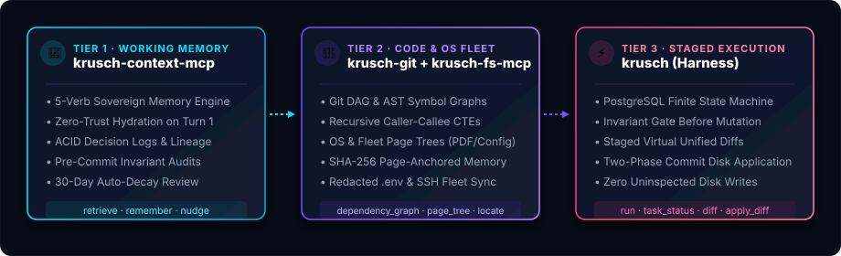

<div align="center">

  

  <br/><br/>

  [](https://krusch.dev)
  [](https://github.com/kruschdev/krusch-companion)
  [](https://github.com/kruschdev/krusch-context-mcp)
  [](https://github.com/kruschdev/krusch-fs-mcp)
  [](https://github.com/RouteWorks/RouterArena/pull/169)
  [](https://github.com/kruschdev)
  [](https://www.linkedin.com/in/kevin-saylor-ruschman-1080493a3/)
  [](https://x.com/Kev96790724)

  <br/>

  ### Sovereign Personal AI · Local-First Agent Infrastructure · Sub-15µs Cascade Routing
</div>

---

### 💡 Engineering Premise

> **Language models are probabilistic samplers; modifying your codebase or managing confidential client knowledge requires a deterministic transaction manager.**

I build sovereign, local-first agent infrastructure so AI coding agents can plan, navigate, and verify multi-step tasks without mutating your physical disk until verified. State lives in PostgreSQL, models remain completely swappable, and operations enforce strict transactional invariants.

---

### 🛠️ The 3-Tier Sovereign Agent Ecosystem

Standardized across **Antigravity**, **Claude Code**, **Cursor**, and **Windsurf**:

<div align="center">
  
</div>

<br/>

| Tier | Subsystem | Authoritative Responsibility | Key Capabilities |
| :--- | :--- | :--- | :--- |
| **Tier 1** | [**`krusch-context-mcp`**](https://github.com/kruschdev/krusch-context-mcp) | **Working Memory & Invariants** | 5-verb sovereign memory engine (`retrieve`, `remember`, `revise`, `nudge`, `health`). Eliminates agent amnesia with ACID decision logs, lineage tracking, and pre-commit invariant gates. |
| **Tier 2A** | [**`krusch-git`**](https://github.com/kruschdev/krusch-git) | **AST Code Graph & Exploration** | Full Git DAG in PostgreSQL, AST symbol extraction, caller-callee call graphs via recursive relational CTEs, 40-char SHA pinning, and exponential temporal recency decay. |
| **Tier 2B** | [**`krusch-fs-mcp`**](https://github.com/kruschdev/krusch-fs-mcp) | **OS Filesystem & Multi-Node Fleet Memory** | 6-verb MCP server powered by **KruschNexus Library Mode**. Indexes PDFs, DOCX, `/etc/systemd/system`, `/etc/fstab`, and `.env` keys across local & SSH server fleets into SHA-256 drift-verified page trees. |
| **Tier 3** | [**`krusch` (Harness)**](https://github.com/kruschdev/krusch) | **Staged Execution & Verification** | PostgreSQL state machine, invariant gate before mutation, virtual unified diff staging, and two-phase commit (2PC) disk application. **Zero uninspected disk writes.** |
| **Bridge** | [**`@krusch/polygres-connector`**](https://github.com/kruschdev/krusch-polygres-connector) | **Zero-Friction Cloud Substrate** | Cloud connector marrying KruschContext with pgGraph and Wondersearch with 40-char SHA pinning, cross-substrate joins, and strict ABA Model Rule 1.6 air-gap protection. |

---

### 🚀 Flagship Systems & Open-Source Projects

#### 🛡️ [krusch-companion](https://github.com/kruschdev/krusch-companion) · `Sovereign Personal AI & Daily Execution Companion (v1.2)`
A 100% private, local-first alternative to cloud-tethered personal assistants (such as OpenAI Dot, Grok Companion, or Meta Muse). Combines live voice dictation, a Dual-Axis Priority Board, and a 16-tool agentic proxy on local SQLite WAL.
- **Voice-to-Text Everywhere (`🎙️ Speak`)**: Built-in Web Speech dictation across Companion Chat and Thought Stream with hands-free `Auto-Send on Stop`.
- **Dual-Axis Priority Board**: 4 Execution Lanes (`🔥 Do Now`, `⚡ Next Up`, `🗓️ Scheduled`, `🧊 Someday`) × 6 Life Pillars (`🏠 Home`, `💼 Career`, `💪 Health`, `💰 Finance`, `🤝 People`, `🌱 Growth`) to resolve the "Priority Paradox".
- **16-Tool `<holodata>` Agentic Proxy**: Includes Google AP2 Payment Mandates and Google Wallet Passes with Confirm-Before-Act safety gates.
- **Microsecond Routing & Zero Cloud Egress**: Employs `krusch-cascade-router` (<15µs CPU L0 fast-path) + local Ollama ($0.00/day) or optional OpenRouter Zero Data Retention mode (`data_collection: "deny"`).

#### 🗂️ [krusch-fs-mcp](https://github.com/kruschdev/krusch-fs-mcp) · `OS Filesystem & Multi-Node Fleet Page Memory (v0.3.0-alpha)`
A lightweight, opt-in 6-verb Model Context Protocol server turning unstructured host directories (`~/Documents`, `~/Downloads`), system configs (`/etc/systemd/system`, `/etc/fstab`), and multi-node SSH/Tailscale server fleets into a deterministic, page-indexed memory substrate.
- **KruschNexus Library Mode**: Parses PDFs, DOCX, Markdown, and configs into layout-true page trees (`krusch_fs_page_tree`, `krusch_fs_read_page`) instead of blind token slices.
- **Co-Located `PageMemory` with Drift Detection**: Pin operational notes or warnings directly to `(node, path, page_number, page_hash)` via `krusch_fs_remember_on_page` with automatic `VALID` vs. `STALE_DRIFT` SHA-256 verification.
- **Multi-Layer Secret Shield**: Blocks `~/.ssh`, `~/.gnupg`, `*.pem`, `*.key`, and package lockfiles; indexes `.env` variable **key names** while automatically redacting secret values (`[REDACTED BY KRUSCH-FS SHIELD]`).
- **Zero-Daemon SSH Fleet Sync**: Agentless SSH/Tailscale fleet indexer (`krusch_fs_sync` / `krusch-fs sync-fleet`) aggregating multi-node state into a single SQLite WAL or PostgreSQL database.

#### 🧠 [krusch-context-mcp](https://github.com/kruschdev/krusch-context-mcp) · `Persistent Working Memory & Invariant Steering`
A lightweight, 5-tool Model Context Protocol server giving AI coding agents (Claude Code, Cursor, Windsurf, Antigravity) persistent memory and rule enforcement across sessions.
- **5 Core Verbs**: `retrieve`, `remember`, `revise`, `nudge`, `health` constrained to `<350` prompt tokens.
- **Temporal Fact Superseding**: Invalidation engine with lineage links that retires obsolete rules and prevents contradictory prompt context.
- **Pre-Commit Invariant Gate**: Audits code diffs against project rules before disk mutation to prevent silent regressions.
- **SQLite-First**: Zero-Docker setup built on `node:sqlite` with optional PostgreSQL dual-engine sync.

#### ⚡ [krusch-cascade-router](https://github.com/kruschdev/krusch-cascade-router) · `Sub-15µs CPU Routing`
Dual-stage microsecond cascade router designed for CPU-only execution. Evaluates semantic difficulty, token length, query structure, and sensitivity to route requests across free, cheap, and frontier models.
- **Latency**: Sub-15µs L1 heuristic gating; sub-8ms L2 dense vector centroid scoring.
- **Speculative Hedging**: Automatically dispatches hedge requests when fast models return ambiguous outputs.
- **Cost Reduction**: Slashes aggregate inference spend by 7–9% while beating baseline Sonnet 3.5 quality scores.

#### 🔌 [@krusch/polygres-connector](https://github.com/kruschdev/krusch-polygres-connector)
Cloud connector bridging local sovereign agent memory and codebase graphs with Polygres Cloud and Wondersearch.
- **Cross-Substrate Marriage**: `getSymbolContext()` resolves AST definitions, recursive caller CTEs, and active steering invariants in a single database round-trip.
- **Refactor Safety Gate**: Automatically flags `requiresCallerAudit = true` whenever a symbol with inbound callers is modified or renamed.
- **Air-Gap Boundary**: Enforces fail-closed isolation for privileged litigation matters and confidential commercial contracts.

#### ⚖️ [krusch-law](https://github.com/kruschdev/krusch-law)
100% air-gapped sovereign legal intelligence platform.
- **Zero Hallucination Grounding**: Enforces a 0.00% False Support Rate across statutory tenant protection codes and appellate cases.
- **Statutory Precedence DAG**: Traverses jurisdictional overrides and local ordinances with strict citation spine coordinates.
- **Air-Gap Compliance**: Runs strictly on local PostgreSQL 16 with realpath denial blocking cloud egress under ABA Model Rule 1.6.

#### 📑 [krusch-nexus](https://github.com/kruschdev/krusch-nexus)
Universal high-throughput document extraction and dual-provider RAG substrate.
- **Deterministic TOC Parser**: Extracts hierarchical document outlines in `<5ms`.
- **4-Stage Retrieval Ablation**: Vector-only, FTS-only, hybrid, and RRF + local cross-encoder reranking.

---

### 💻 Tech Stack & Sovereign Philosophy

```
  Languages        : TypeScript (ESM) · Python 3.12 · Rust · SQL · C/C++
  Databases        : PostgreSQL 16 · pgvector · SQLite (WAL) · DuckDB
  Agent Protocol   : Model Context Protocol (MCP) · JSON-RPC · SSE Streams
  Code & OS Index  : Tree-Sitter AST · KruschNexus Page Trees · SHA-256 Drift Guards
  Infrastructure   : 8-Node Homelab Fleet · Linux (Ubuntu/Pop!_OS) · Tailscale Mesh · Docker
```

- **PostgreSQL-First Proxy**: Operational data, AST symbols, and agent episodic memories persist in relational PostgreSQL with strict relational foreign keys and indexes.
- **Fail-Closed Air-Gaps**: Cloud egress is opt-in (`ALLOW_CLOUD=1`). Private files, counterparty terms, and litigation matters remain strictly on-premises.
- **Deterministic Over Probabilistic**: Prompt chains are constrained by state machines, invariant verification gates, and atomic rollback journals.

---

### 📊 Verified Systems & Performance Benchmarks

<div align="center">
  
</div>

<br/>

<div align="center">
  
</div>

---

### 📖 Selected Articles & Deep Dives

- 🗂️ [**krusch-fs-mcp: OS Filesystem Page Memory, SHA-256 Drift Detection, and Multi-Node Fleet Indexing for AI Agents**](https://krusch.dev/articles/krusch-fs-architecture.html) — *Replacing blind `find`/`cat` loops with KruschNexus page trees, SHA-256 page-anchored annotations, and secret-redacted SSH fleet indexing.*
- 🛡️ [**Introducing Krusch Companion: A Sovereign, Voice-First Personal AI Assistant & Dual-Axis Daily Execution Engine**](https://krusch.dev/articles/introducing-krusch-companion.html) — *Voice-to-Text Everywhere, the Dual-Axis Priority Board, and the 16-tool `<holodata>` proxy.*
- 💾 [**Zero-Friction Agent Substrates: Powering KruschContext & KruschGit with Swappable Local & Polygres Drives**](https://krusch.dev/articles/zero-friction-sovereignty-polygres.html) — *How AI coding agents eliminate amnesia with ACID decision logs and navigate code with relational AST graphs.*
- ⚡ [**Multi-Tier Cascade Routing: Slashing Enterprise Inference Budgets by 60–80%**](https://krusch.dev/articles/multi-tier-cascade-routing.html) — *Benchmarking sub-15µs CPU gating, neural centroids, and speculative parallel hedging.*

---

<div align="center">
  <sub>Engineered by <strong>Kevin Ruschman (@kruschdev)</strong> · <a href="https://krusch.dev">krusch.dev</a></sub>
</div>
